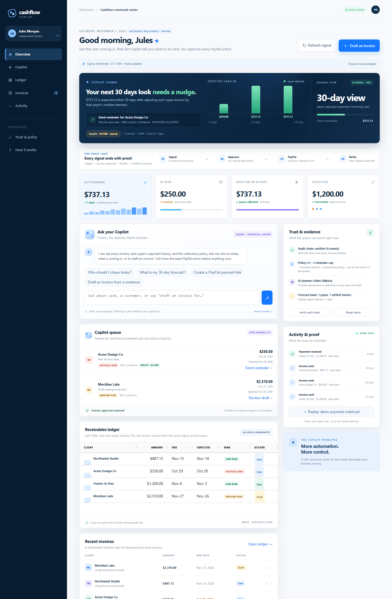
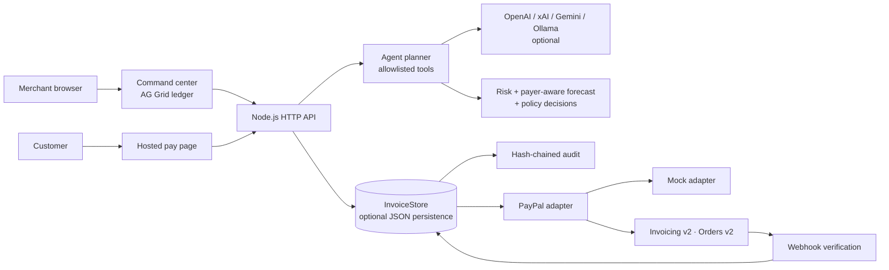
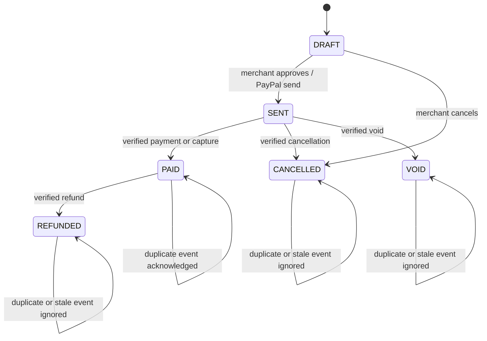

# Cashflow Copilot


**The AI accounts-receivable operator that tells you which invoice to chase next — and only moves money after you approve.**

Cashflow Copilot turns a sentence into a validated PayPal invoice, predicts **when each invoice will actually be paid** using that payer's history, ranks the one action that moves cash this week, and executes it through PayPal only after explicit approval. Every recommendation is explained, every collections rule is data, and every timeline event is SHA-256 hash-chained.

Built for the **PayPal AI Hackathon: Build What's Next** (October–November 2026).



> **The quantified differentiator:** on a deterministic synthetic ledger, payer-aware forecasting reduces mean absolute error for payment-date prediction by **70.4% versus a due-date baseline** (2.36 days vs 7.98 days). The backtest is committed and reproducible with `npm run backtest` — see [`docs/FORECAST_BACKTEST.md`](docs/FORECAST_BACKTEST.md).

**Project status:** the application, tests, and documentation are complete. Three owner-only steps remain before Devpost submission: a real PayPal Sandbox evidence run, a hosted Render deployment, and an under-three-minute video. See [`docs/FINAL_HANDOFF.md`](docs/FINAL_HANDOFF.md).

---

## Contents

- [The problem](#the-problem)
- [Who it is for](#who-it-is-for)
- [What makes it different](#what-makes-it-different)
- [Product walkthrough](#product-walkthrough)
- [Feature deep dive](#feature-deep-dive)
  - [Natural language to a validated invoice](#natural-language-to-a-validated-invoice)
  - [Agent plan with per-step approval](#agent-plan-with-per-step-approval)
  - [Payer-aware forecasting](#payer-aware-forecasting)
  - [Policy as data](#policy-as-data)
  - [PayPal execution: Invoicing plus Checkout](#paypal-execution-invoicing-plus-checkout)
  - [Verified webhooks and payment integrity](#verified-webhooks-and-payment-integrity)
  - [Hash-chained audit trail](#hash-chained-audit-trail)
  - [The customer pay page](#the-customer-pay-page)
  - [Optional persistence and demo reset](#optional-persistence-and-demo-reset)
- [Architecture](#architecture)
  - [Runtime topology](#runtime-topology)
  - [Invoice lifecycle](#invoice-lifecycle)
  - [Data model](#data-model)
  - [Module map](#module-map)
- [Live vs demo: the claim boundary](#live-vs-demo-the-claim-boundary)
- [Quick start](#quick-start)
- [Configuration reference](#configuration-reference)
- [PayPal Sandbox mode](#paypal-sandbox-mode)
- [AI providers and the planner](#ai-providers-and-the-planner)
- [Forecasting methodology and backtest](#forecasting-methodology-and-backtest)
- [Security model](#security-model)
- [API reference](#api-reference)
- [Collections policy reference](#collections-policy-reference)
- [Sponsor integrations](#sponsor-integrations)
- [Tests and evidence](#tests-and-evidence)
- [Deployment](#deployment)
- [Troubleshooting](#troubleshooting)
- [Limitations and roadmap](#limitations-and-roadmap)
- [FAQ](#faq)
- [Repository map](#repository-map)
- [Submission assets](#submission-assets)
- [License and third-party notices](#license-and-third-party-notices)

---

## The problem

Small businesses do not fail because they cannot write an invoice. They lose momentum because they do not know **which payment deserves attention next** — and because the tools that could act on that signal are either dashboards that stop at a chart or agents that are not accountable enough to trust with money.

A freelancer with fourteen open invoices faces four questions every morning:

1. Which invoice is actually late versus merely not paid yet?
2. Which client habitually pays twelve days after the due date?
3. Which reminder is allowed by my own policy, and which is nagging?
4. Did the payment actually arrive, or did I mark it paid because a client said so?

Invoicing software answers the first half. Generic AI chat can write text. Neither owns the loop from **intent → validated action → PayPal execution → verified outcome**, with a human in the middle.

---

## Who it is for

- **Freelancers and small studios** who invoice a handful of clients and cannot afford a full finance team.
- **Small agencies and consultancies** with recurring clients, mixed payment behaviour, and no dedicated collections function.
- **Merchants already on PayPal** who want their invoices, checkout, and payment events in one operating loop instead of three disconnected tools.

The demo persona is a three-person independent studio with four invoices in different states: one overdue, one due soon, one paid, and one draft. The seed data is generated relative to "today", so the demo still makes sense whenever a judge runs it.

---

## What makes it different

The AR/invoicing cluster in this hackathon is crowded. Most projects stop at "AI writes an invoice." Cashflow Copilot owns the harder half:

| Most invoice demos | Cashflow Copilot |
| --- | --- |
| Generates invoice text | Generates a **validated, editable proposal**, then recalculates every total server-side in integer cents |
| Sends an invoice | Creates, sends, reminds, and cancels through **PayPal Invoicing v2**, and creates **PayPal Checkout** links for customers |
| Says "paid" | Moves to PAID only on a **verified PayPal webhook or a confirmed capture**, with idempotency and stale-event protection |
| Shows a chart | Predicts **when** each invoice will be paid from payer history, with a visible basis and confidence |
| Asks an LLM for advice | Runs a **planner with an allowlist of five financial tools**; the model can propose, never execute |
| Logs actions | Keeps a **SHA-256 hash-chained audit trail** you can verify from the UI or API |
| Hard-codes rules in prompts | Keeps collections rules in **`policies/collections.json`**, with the exact rule id and numeric inputs attached to every recommendation |
| Merchant-only | **Two-sided**: a merchant command center and a hosted customer checkout page |

The product's loop is: **Signal → Approve → PayPal → Verify**.

---

## Product walkthrough

### The merchant command center

The dashboard is organized around the decision, not the data:

- **Forecast panel** — expected cash in 7/14/30 days, adjusted by payer history, plus the single highest-impact next action.
- **Trust loop strip** — Signal → Approve → PayPal → Verify, the same order the server enforces.
- **Metric cards** — outstanding sent invoices, amount at risk, expected 30-day cash, and collected cash.
- **Copilot chat** — ask questions in natural language and receive an explainable plan with per-step approval.
- **Copilot queue** — invoices ranked by risk and policy eligibility, with confidence, expected payment date, and the policy rule.
- **AG Grid ledger** — sortable, resizable receivables ledger; every row opens the invoice control room.
- **Trust & evidence panel** — audit-chain status, policy version, AI planner provenance, forecast basis, verify/reset actions.
- **Activity & proof** — the most recent seed, simulated, PayPal, and verified-webhook events.
- **Invoice control room** — amount, risk explanation, expected date, policy decision, PayPal ids, reminder history, actions, and the hash-chained timeline.

### The customer pay page

`/pay/{token}` is a separate, customer-safe surface:

- Invoice number, merchant, due date, line items, subtotal, tax, and total.
- A PayPal button that creates an Orders v2 checkout and redirects to PayPal in sandbox mode.
- A clearly labelled mock checkout in demo mode.
- A paid receipt with the PayPal reference after capture.
- No PayPal invoice ids, order ids, or audit events leak to the customer.

### The complete flow, end to end

1. The merchant describes work: *"Invoice Acme Design Co for 2 brand review sessions at $125 each, tax 8%, due in 15 days."*
2. `POST /api/parse-invoice` returns a draft plus AI provenance.
3. The merchant edits the draft; the server recalculates totals and stores it as `DRAFT`.
4. `POST /api/invoices/{id}/send` creates and sends the invoice through the configured adapter, appends an audit event, and moves it to `SENT`.
5. `GET /api/insights` ranks risk, applies policy, and computes a payer-adjusted expected payment date.
6. `POST /api/copilot/plan` returns an answer and proposed steps; nothing executes.
7. The merchant approves selected steps; `POST /api/copilot/execute` runs only those and records each result.
8. `POST /api/invoices/{id}/payment-link` creates (or reuses) a PayPal Checkout order and a hosted pay URL.
9. The customer pays on `/pay/{token}`; the app captures the order and records `PAYMENT.CAPTURE.COMPLETED`.
10. PayPal webhooks are signature-verified before any state change; duplicates and stale events are handled.
11. `GET /api/audit` recomputes the SHA-256 chain over every invoice timeline.

---

## Feature deep dive

### Natural language to a validated invoice

The deterministic parser is a first-class path, not a degraded fallback. It handles:

- `Invoice Acme Design Co <accounts@acme.example> for 2 brand review sessions at $125 each, tax 8%, due in 15 days`
- `Create an invoice for Northwind Studio ... for 1 cashflow setup at $450, due 2026-11-30`
- Multi-line invoices with hourly and fixed items.
- Labelled customers (`Bill to`, `Customer:`, `Client:`).
- Multiple items joined by `and`, commas, or semicolons.
- Thousands separators (`$2,000` is one price, not two line items).
- Percentage-first tax (`8.5% tax`) and trailing tax (`tax 8%`).
- Relative dates (`due in 15 days`, `due in 2 weeks`, `net 30`) and written dates.
- Currency symbols (`€`, `£`, `¥`, `₹`) and explicit ISO codes.

When an OpenAI-compatible provider is configured, the model can perform the extraction instead. Its JSON is schema-validated, and any provider error, timeout, or malformed response falls back to the deterministic parser. The server recalculates every total in cents; the model never does arithmetic.

**Why the parser rewrite mattered:** the original parser skipped any line beginning with "Invoice", so the exact first demo prompt produced zero line items. `tests/core.test.js` and `scripts/eval.js` now pin both demo prompts.

### Agent plan with per-step approval

The agent has two jobs:

1. Answer a merchant question from real invoice data.
2. Propose a short list of concrete actions.

It never executes anything itself. The planner returns a plan with a **15-minute TTL**; `POST /api/copilot/execute` takes the plan id plus the **specific step ids** the merchant approved.

| Tool | What it does | Execution |
| --- | --- | --- |
| `remind_invoice` | Sends a PayPal invoice reminder | Server, after approval |
| `send_invoice` | Sends a draft through the adapter | Server, after approval |
| `cancel_invoice` | Cancels a draft or sent invoice | Server, after approval |
| `create_payment_link` | Creates/reuses a Checkout order and pay URL | Server, after approval |
| `draft_invoice` | Opens the editable review modal | Client only |

The model receives a compact context (invoices, risk, due dates, payer stats, policy) and must return JSON. Every action is validated:

- The tool must be in the allowlist.
- The invoice id must exist in the store.
- The invoice status must permit the action (`remind` only for `SENT`, `send` only for `DRAFT`, and so on).
- The plan is capped at eight steps.

Invalid output falls back to the deterministic planner, with the fallback reason visible in `plan.ai`.

### Payer-aware forecasting

The forecast is deliberately small and explainable:

```text
expected payment date = due date + median observed lateness for that payer
```

Fallbacks, in order:

1. Payer median lateness, when the payer has at least two settled invoices.
2. Portfolio median lateness, when there are at least five settled invoices overall.
3. The due date.

Every insight exposes:

- `expectedPaymentDate`
- `expectedDaysFromNow`
- `forecastBasis` (`payer_median_lateness`, `portfolio_median_lateness`, `due_date`, `no_due_date`)
- `forecastConfidence`
- `payerMedianLatenessDays`
- `payerPaidCount`

The 7/14/30-day projections use the expected date, not just the due date. See [Forecasting methodology and backtest](#forecasting-methodology-and-backtest).

### Policy as data

Collections rules live in `policies/collections.json` — not in a prompt:

```json
{
  "version": 1,
  "reminders": {
    "minDaysOverdue": 1,
    "cooldownHours": 0,
    "maxReminders": 3,
    "minAmount": 0,
    "escalateAfterReminders": 2
  },
  "sending": {
    "requireApproval": true,
    "maxInvoiceTotal": 100000
  },
  "writeOff": {
    "afterDaysOverdue": 90,
    "maxAmount": 500
  }
}
```

Every reminder recommendation carries a policy decision:

| Rule id | Meaning | Result |
| --- | --- | --- |
| `REMINDER_ALLOWED` | Eligible under all rules | Action allowed |
| `REMINDER_LIMIT_REACHED` | Max reminders already sent | Escalate instead |
| `NOT_OVERDUE_ENOUGH` | Below the minimum overdue threshold | Hold |
| `BELOW_MIN_AMOUNT` | Invoice below the reminder minimum | Skip |
| `COOLDOWN_ACTIVE` | A reminder was sent inside the cooldown | Hold |
| `SEND_LIMIT_EXCEEDED` | Draft total above the send cap | Review limit |

Each decision includes `ruleId`, `rule`, `inputs` (days overdue, reminder count, last reminded at, amount), `allowed`, and `decision`. The UI shows the rule and the numbers in the queue and the invoice drawer. The model cannot talk its way past these rules.

### PayPal execution: Invoicing plus Checkout

The server uses the PayPal REST surface directly, with no SDK dependency:

| Capability | Endpoint |
| --- | --- |
| OAuth 2.0 | `POST /v1/oauth2/token` |
| Create invoice | `POST /v2/invoicing/invoices` |
| Send invoice | `POST /v2/invoicing/invoices/{id}/send` |
| Read invoice | `GET /v2/invoicing/invoices/{id}` |
| Remind invoice | `POST /v2/invoicing/invoices/{id}/remind` |
| Cancel invoice | `POST /v2/invoicing/invoices/{id}/cancel` |
| Create checkout order | `POST /v2/checkout/orders` |
| Capture checkout order | `POST /v2/checkout/orders/{id}/capture` |
| Verify webhook | `POST /v1/notifications/verify-webhook-signature` |

**Tax correctness:** PayPal invoices are built with per-item `tax` objects allocated proportionally from the invoice tax total, with rounding remainder assigned to the last item. The PayPal invoice total therefore equals the app total. The original implementation omitted tax entirely; a test now asserts parity.

**Token handling:** OAuth access tokens are cached until shortly before expiry. Outbound requests are bounded by `PAYPAL_TIMEOUT_MS` (default 10 s, max 120 s).

**Checkout:** the server creates an order with `intent: CAPTURE`, one purchase unit, and a return/cancel URL derived from the request origin (or `PUBLIC_BASE_URL`). In sandbox mode the customer is redirected to PayPal's approval page, then returns to `/pay/{token}?status=return`, where the app captures the order. In mock mode the adapter simulates an order and capture.

**Idempotency:** duplicate sends are locked; duplicate captures return `duplicate: true`; duplicate webhook event ids do not append another event.

### Verified webhooks and payment integrity

`POST /api/webhooks/paypal` is intentionally strict:

1. The sandbox adapter must be active.
2. `PAYPAL_WEBHOOK_ID` and all five `PAYPAL-*` signature headers are required.
3. The event is forwarded to PayPal's `/v1/notifications/verify-webhook-signature`.
4. The certificate URL must be HTTPS on a PayPal host (`*.paypal.com`, `*.paypalobjects.com`, `*.paypal.cn`); otherwise verification is rejected before the outbound request.
5. Only after `verification_status === "SUCCESS"` is the event applied.
6. Event ids are deduplicated; stale events cannot regress a terminal status; unsupported events are acknowledged with `200` and no state change.

The lifecycle is monotonic:

```text
DRAFT → SENT → PAID / CANCELLED / VOID
PAID  → REFUNDED
```

A `PAYMENT.CAPTURE.COMPLETED` webhook can also mark an invoice paid without calling capture again, using the capture resource's `custom_id`/`invoice_id`.

**Simulation is separate and labelled.** `POST /api/webhooks/simulate` is demo-safe, enforces the same transition rules, and records the event with `source: "simulated"`. The UI never presents a simulated event as a live PayPal webhook.

### Hash-chained audit trail

Every invoice timeline is a SHA-256 chain:

```json
{
  "type": "INVOICING.INVOICE.SENT",
  "at": "2026-10-01T09:00:00.000Z",
  "source": "paypal-sandbox",
  "verified": false,
  "actor": "merchant",
  "detail": { "paypalInvoiceId": "INV2-..." },
  "prevHash": "…",
  "hash": "…"
}
```

`GET /api/audit` recomputes the chain for every invoice and returns:

- `valid`
- `checkedEvents`
- `invoiceCount`
- `failures` with the first broken index and event type
- per-invoice results

The UI shows a `CHAIN VERIFIED · N EVENTS` badge in the invoice drawer and a global status in the Trust & evidence panel. Editing an earlier event invalidates every later hash; a test tampers with an event and asserts detection.

### The customer pay page

`/pay/{token}` is served for any unguessable 24-character token. The API projection excludes merchant-only fields. The page:

- renders the invoice and totals,
- creates/reuses a PayPal order,
- redirects to PayPal in sandbox mode,
- captures on return and shows a paid receipt,
- runs a labelled mock checkout in demo mode.

Security: the token is random (144 bits), the route is rate-limited, and the capture endpoint rejects an order id that does not belong to the invoice.

### Optional persistence and demo reset

By default the store is in memory: a deliberate prototype boundary that keeps the zero-config demo simple. Set `DATA_FILE` to persist:

```sh
DATA_FILE=./data/store.json npm start
```

Writes are debounced and atomic (temporary file + rename); `SIGTERM`/`SIGINT` flush pending writes before exit. The JSON contains invoice data and audit events, never secrets. On restore, the sequence and adapter sequence are recovered, and stale mock checkout orders are cleared because the mock adapter has no durable order store.

`POST /api/demo/reset` reseeds four invoices relative to the current time. On a public deployment, set `DEMO_RESET_SECRET` and send `Authorization: Bearer <secret>` to reset.

---

## Architecture

### Runtime topology



Detailed sequence diagrams live in [`docs/ARCHITECTURE.md`](docs/ARCHITECTURE.md).

### Invoice lifecycle



### Data model

An invoice contains:

| Field | Meaning |
| --- | --- |
| `id` | Internal id (`inv_00001`, or `inv_seed_XXX` for seeds) |
| `customer` | `{ name, email }` |
| `currency` | ISO 4217 code |
| `dueDate` | `YYYY-MM-DD` or null |
| `items[]` | `{ description, quantity, unitPrice, amount }` |
| `subtotal`, `taxRate`, `tax`, `total` | Server-calculated, cent-safe |
| `notes`, `reference` | Optional metadata |
| `status` | `DRAFT`, `SENT`, `PAID`, `CANCELLED`, `VOID`, `REFUNDED` |
| `paypalInvoiceId` | PayPal invoice id when created |
| `payToken` | Unguessable customer payment-link token |
| `paypalOrderId`, `orderStatus`, `orderApproveUrl` | Checkout state |
| `reminderCount`, `lastRemindedAt` | Reminder state |
| `paidAt`, `paymentReference` | Payment proof |
| `createdAt`, `updatedAt` | Timestamps |
| `events[]` | Hash-chained audit events |

### Module map

| Module | Responsibility |
| --- | --- |
| `src/core.js` | Validation, cent-safe totals, PayPal adapters, lifecycle, insights integration |
| `src/agent.js` | Deterministic and LLM planners, allowlisted tool execution, plan TTL |
| `src/policy.js` | Policy as data; named rules for reminders and send limits |
| `src/forecast.js` | Payer statistics, expected payment date, projections, backtest |
| `src/audit.js` | SHA-256 chain append and verification |
| `src/persistence.js` | Optional atomic JSON persistence |
| `src/server.js` | Routing, security headers, origin checks, rate limiting, pay page, webhooks |

---

## Live vs demo: the claim boundary

Honesty is part of the design. The UI always labels the active mode, and this table is the canonical claim boundary.

| Capability | Demo mode (default, no keys) | PayPal Sandbox mode (credentials set) | Evidence |
| --- | --- | --- | --- |
| Invoice create/send/remind/cancel | Mock adapter, clearly labelled | Invoicing v2 REST | Unit tests with mocked PayPal responses; `npm run sandbox:check` for a real run |
| Customer checkout | Mock order + mock capture | Orders v2 create + capture, buyer redirected to PayPal | Unit tests; the sandbox script covers invoicing, not checkout |
| Webhook state changes | Labelled simulation | Signature verified by PayPal before any change | Tests cover valid, invalid, duplicate, stale, and untrusted cert URL |
| AI extraction / planner | Deterministic fallback, labelled | OpenAI-compatible provider, validated JSON, deterministic fallback | `npm run eval` 16/16 goldens |
| Forecast | Payer-aware model over local history | Same model over sandbox history | `npm run backtest` |
| Audit chain | Real SHA-256 chain | Real SHA-256 chain | `GET /api/audit`, tests |
| Persistence | In-memory by default; optional JSON file | Same | Persistence round-trip test |

A real sandbox run has **not** been committed in this repository yet. Run `npm run sandbox:check` with your credentials before submission and commit the generated JSON under [`docs/sandbox-evidence/`](docs/sandbox-evidence/). Do not claim a live run you cannot show. The long-form boundary is in [`docs/LIVE_VS_DEMO.md`](docs/LIVE_VS_DEMO.md).

---

## Quick start

### Requirements

- **Node.js 22 or newer** (the repo pins 22 in `.nvmrc`; verified on Node 24.21.0).
- No database, no Docker, no API keys for the demo.
- A modern browser.

### Run the demo (no credentials)

```sh
git clone https://github.com/sidg2hp/paypal.git
cd paypal
npm ci
npm start
```

Open <http://localhost:3000>. The app starts in `MOCK MODE` with four seeded invoices relative to today.

### Run with PayPal Sandbox

```sh
PAYPAL_CLIENT_ID=... PAYPAL_CLIENT_SECRET=... npm start
```

On Windows PowerShell:

```powershell
$env:PAYPAL_CLIENT_ID="..."
$env:PAYPAL_CLIENT_SECRET="..."
npm start
```

Check the mode:

```sh
curl -s http://localhost:3000/api/health
```

### Commands

| Command | What it does |
| --- | --- |
| `npm start` | Start the server on `PORT` (default 3000) |
| `npm run dev` | Start with Node's watch mode |
| `npm test` | Run 58 offline tests |
| `npm run check` | Syntax-check every source, frontend, and script file |
| `npm run eval` | Run 16 golden parser/planner cases |
| `npm run backtest` | Regenerate the forecast report |
| `npm run verify` | `check` + `test` + `eval` |
| `npm run sandbox:check` | Real PayPal Sandbox evidence run |

### Optional local configuration

```sh
DATA_FILE=./data/store.json npm start
POLICY_FILE=./policies/collections.json npm start
AI_PROVIDER=ollama npm start
```

Copy [`.env.example`](.env.example) for the full variable list. The app reads variables from the process environment; it does not load `.env` automatically, so either export them, use your shell's env-file support, or use a local loader.

---

## Configuration reference

### Core

| Variable | Default | Purpose |
| --- | --- | --- |
| `PORT` | `3000` | HTTP port |
| `PUBLIC_BASE_URL` | derived from request | Public origin for PayPal return/cancel URLs |
| `TRUST_PROXY` | off | Set `1` behind Render/nginx so `X-Forwarded-*` is trusted |
| `MERCHANT_NAME` | `Cashflow Copilot` | Name shown on the customer pay page |
| `NODE_ENV` | — | Standard Node environment flag |

### PayPal

| Variable | Default | Purpose |
| --- | --- | --- |
| `PAYPAL_CLIENT_ID` | — | Sandbox client id |
| `PAYPAL_CLIENT_SECRET` | — | Sandbox secret |
| `PAYPAL_WEBHOOK_ID` | — | Required for verified webhooks |
| `PAYPAL_BASE_URL` | `https://api-m.sandbox.paypal.com` | PayPal API origin |
| `PAYPAL_BRAND_NAME` | `Cashflow Copilot` | Checkout brand name |
| `PAYPAL_INVOICER_EMAIL` | — | Optional invoicer email |
| `PAYPAL_TIMEOUT_MS` | `10000` | PayPal request timeout (max 120000) |
| `OUTBOUND_TIMEOUT_MS` | `10000` | Shared fallback timeout for PayPal and AI |

If only one of `PAYPAL_CLIENT_ID` / `PAYPAL_CLIENT_SECRET` is set, the server refuses to start rather than silently falling back to mock.

### AI

| Variable | Default | Purpose |
| --- | --- | --- |
| `AI_PROVIDER` | `auto` | `auto`, `deterministic`, `ollama`, `openai`, `grok`/`xai`, `gemini`/`google` |
| `AI_TIMEOUT_MS` | `10000` | Provider request timeout (max 120000) |
| `OPENAI_API_KEY`, `OPENAI_BASE_URL`, `OPENAI_MODEL` | —, `https://api.openai.com/v1`, `gpt-4o-mini` | OpenAI-compatible provider |
| `XAI_API_KEY`, `XAI_BASE_URL`, `XAI_MODEL` | —, `https://api.x.ai/v1`, `grok-3-mini` | xAI/Grok (aliases `GROK_API_KEY`, `GROK_MODEL`) |
| `GEMINI_API_KEY`, `GEMINI_BASE_URL`, `GEMINI_MODEL` | —, `https://generativelanguage.googleapis.com/v1beta/openai`, `gemini-2.0-flash` | Gemini (alias `GOOGLE_API_KEY`) |
| `OLLAMA_BASE_URL`, `OLLAMA_MODEL` | `http://127.0.0.1:11434/v1`, `llama3.2` | Local Ollama |
| `OLLAMA_PROBE_URL`, `OLLAMA_PROBE_TIMEOUT_MS` | derived, `250` | Bounded local detection |

`AI_PROVIDER=auto` chooses the first configured cloud key in the order OpenAI, xAI, Gemini, then probes local Ollama, then falls back to deterministic. Tests inject fetch and never call a real provider.

### Operations

| Variable | Default | Purpose |
| --- | --- | --- |
| `DATA_FILE` | unset | Optional JSON persistence path |
| `POLICY_FILE` | `policies/collections.json` | Policy override |
| `DEMO_RESET_SECRET` | unset | Bearer token required for `POST /api/demo/reset` |
| `ALLOW_WEBHOOK_SIMULATION` | `true` | Set `false` to disable the demo replay route |
| `ALLOW_CROSS_ORIGIN` | off | Set `1` only for a trusted cross-origin client |
| `RATE_LIMIT_DISABLED` | off | Set `1` to disable rate limiting (tests/dev only) |
| `RATE_LIMIT_WINDOW_MS` | `60000` | Rate-limit window |
| `RATE_LIMIT_MAX` | `240` | Reads per IP per window |
| `RATE_LIMIT_WRITE_MAX` | `60` | Writes per IP per window |
| `SANDBOX_TEST_EMAIL` | `sb-buyer@business.example.com` | Recipient for the evidence run |
| `SANDBOX_TEST_CURRENCY` | `USD` | Currency for the evidence run |

---

## PayPal Sandbox mode

1. Create a PayPal Developer account at <https://developer.paypal.com/dashboard/>.
2. Open **Apps & Credentials → Sandbox**, create a REST app, and copy the client id and secret.
3. Create a sandbox **personal** account under **Accounts** to act as the buyer.
4. Start the server with both credentials:

```sh
PAYPAL_CLIENT_ID=... PAYPAL_CLIENT_SECRET=... npm start
```

5. Confirm `/api/health` reports `"mode": "sandbox"`.
6. Create, send, and remind an invoice from the UI.
7. Generate real evidence:

```sh
PAYPAL_CLIENT_ID=... PAYPAL_CLIENT_SECRET=... \
SANDBOX_TEST_EMAIL=sb-buyer@business.example.com \
npm run sandbox:check
```

8. Commit the generated JSON under `docs/sandbox-evidence/`.
9. Create a webhook subscription pointing at `https://YOUR_HOST/api/webhooks/paypal`, set `PAYPAL_WEBHOOK_ID`, and pay an invoice with the sandbox buyer. The timeline should show **Verified PayPal webhook**.

The step-by-step version, including webhook negative tests and troubleshooting, is in [`docs/SANDBOX_SETUP.md`](docs/SANDBOX_SETUP.md).

**Never use live PayPal credentials in this repository or a public demo.** The adapter, tests, and docs assume sandbox.

---

## AI providers and the planner

The app works with **no AI key** and improves with one.

### Extraction

`POST /api/parse-invoice` first resolves a provider. If one is available, it sends a strict extraction prompt and validates the JSON against the invoice schema. On any failure it falls back to the deterministic parser. The response always includes provenance:

```json
{
  "invoice": { "...": "..." },
  "ai": {
    "provider": "openai",
    "mode": "ai",
    "model": "gpt-4o-mini",
    "fallback": false,
    "reason": null
  }
}
```

### Planning

`POST /api/copilot/plan` builds a compact context and asks the model for:

```json
{
  "intent": "collections_review",
  "answer": "Acme is eight days late; send the policy-approved reminder.",
  "actions": [
    { "tool": "remind_invoice", "invoiceId": "inv_seed_002" }
  ]
}
```

The server validates the intent, the tool allowlist, the invoice ids, and the invoice statuses. Invalid actions are dropped. Invalid JSON falls back to the deterministic plan.

### What the model can never do

- Invent an invoice id, amount, customer, or due date.
- Execute an action directly.
- Bypass policy.
- Move money outside `POST /api/copilot/execute` with approved step ids.
- See secrets, environment variables, or PayPal access tokens.

### Provider examples

```sh
# OpenAI
AI_PROVIDER=openai OPENAI_API_KEY=... npm start

# xAI / Grok
AI_PROVIDER=grok/xai XAI_API_KEY=... npm start

# Gemini / Google
AI_PROVIDER=gemini/google GEMINI_API_KEY=... npm start

# Local Ollama (no key)
ollama pull llama3.2
AI_PROVIDER=ollama npm start
```

Keys are read from the environment only, never returned by `/api/health`, and never logged.

---

## Forecasting methodology and backtest

The model is deliberately small and explainable:

```text
expected payment date = due date + median observed lateness for that payer
```

Lateness is signed: positive means paid after the due date, negative means early. The model trains on settled (`PAID`) invoices with a due date and a payment timestamp. It is a pure function in `src/forecast.js`, reused by the app and the backtest.

`npm run backtest` generates a deterministic synthetic ledger (seed `20261112`, 8 payers, 144 settled invoices), trains on 70% chronologically, and scores the model against two baselines:

| Model | MAE | RMSE | Within 3 days | Within 7 days | Exact date |
| --- | ---: | ---: | ---: | ---: | ---: |
| Due-date baseline | 7.98 d | 11.33 d | 52.3% | 59.1% | 2.3% |
| Global median lateness | 7.11 d | 9.11 d | 22.7% | 65.9% | 0.0% |
| **Payer median lateness** | **2.36 d** | **3.30 d** | **72.7%** | **95.5%** | **20.5%** |

Payer-aware forecasting reduces MAE by **70.4%** versus the due-date baseline.

The exact numbers and methodology are committed in [`docs/FORECAST_BACKTEST.md`](docs/FORECAST_BACKTEST.md). This is a synthetic calibration harness, not a claim about real merchants. Replace `buildSyntheticLedger()` with exported rows to run the same evaluation on real history.

`tests/forecast.test.js` asserts that the payer-aware model beats the due-date baseline, so the claim cannot silently regress.

---

## Security model

### Financial correctness

- All totals are recalculated server-side in integer cents; client- and model-supplied totals are ignored.
- PayPal invoice tax is allocated per item so PayPal and the app agree.
- Lifecycle transitions are monotonic; duplicate sends are locked.
- Webhook events are idempotent; stale events cannot regress a terminal invoice.

### Agent boundary

- Five allowlisted tools.
- Real invoice-id validation.
- Invoice-status checks per action.
- 15-minute plan TTL.
- Per-step approval.
- Policy evaluated outside the model.

### Webhooks

- Required `PAYPAL-*` signature headers and `PAYPAL_WEBHOOK_ID`.
- Verification delegated to PayPal's verification endpoint.
- Certificate URL restricted to PayPal hosts over HTTPS.
- Event-id deduplication.
- Unsupported events acknowledged without a state change.

### HTTP

- CSP with strict `script-src 'self'`; `style-src` allows inline styles because AG Grid injects theme CSS.
- `X-Frame-Options: DENY`, `nosniff`, no-referrer, permissions policy, COOP/CORP.
- Same-origin enforcement on mutating requests (`Origin`, `Sec-Fetch-Site`).
- Per-IP rate limits for reads, writes, payment routes, and webhooks.
- 1 MB request-body cap; valid JSON required.
- Static path traversal protection.
- Optional bearer token for demo reset.

### Secrets

- Environment variables only.
- No secret in `/api/health`, logs, or the browser.
- `scripts/sandbox-check.js` records `PayPal-Debug-Id` values but no credentials or headers.
- `.env`, `data/`, and temporary files are gitignored.

The long-form policy, threat model, and production checklist are in [`SECURITY.md`](SECURITY.md).

---

## API reference

The full contract is [`openapi/openapi.yaml`](openapi/openapi.yaml) (and [`openapi/openapi.json`](openapi/openapi.json)). All responses are JSON unless stated otherwise.

### Health and state

| Method | Route | Purpose |
| --- | --- | --- |
| `GET` | `/api/health` | Secret-free adapter, version, uptime, capabilities, AI status |
| `GET` | `/api/state` | Invoices, summary, policy, runtime metadata |
| `GET` | `/api/insights` | Per-invoice risk, reasons, policy decisions, payer-adjusted forecast |
| `GET` | `/api/policy` | Policy plus the decision ledger |
| `GET` | `/api/audit` | Recompute the hash chain and return failures |

Example `GET /api/health`:

```json
{
  "status": "ok",
  "version": "1.0.0",
  "adapter": "mock",
  "mode": "mock",
  "uptime": 12.4,
  "capabilities": {
    "checkout": true,
    "paypalWebhooks": false,
    "agentPlanner": true,
    "auditChain": true,
    "policyAsData": true
  },
  "ai": {
    "selectedProvider": "deterministic",
    "mode": "deterministic",
    "model": null,
    "fallback": true
  }
}
```

### Invoices

| Method | Route | Purpose |
| --- | --- | --- |
| `POST` | `/api/parse-invoice` | Natural language → validated draft + AI provenance |
| `POST` | `/api/invoices` | Create a draft |
| `POST` | `/api/invoices/{id}/send` | Create/send through PayPal |
| `POST` | `/api/invoices/{id}/remind` | Send a reminder (optional `{ "force": true }`) |
| `POST` | `/api/invoices/{id}/cancel` | Cancel locally and at PayPal |
| `POST` | `/api/invoices/{id}/payment-link` | Create/reuse a Checkout order and pay URL |

Example `POST /api/parse-invoice`:

```json
{
  "text": "Invoice Acme Design Co <accounts@acme.example> for 2 brand review sessions at $125 each, tax 8%, due in 15 days"
}
```

Response:

```json
{
  "invoice": {
    "customer": { "name": "Acme Design Co", "email": "accounts@acme.example" },
    "currency": "USD",
    "dueDate": "2026-11-22",
    "items": [
      { "description": "brand review sessions", "quantity": 2, "unitPrice": 125, "amount": 250 }
    ],
    "subtotal": 250,
    "taxRate": 8,
    "tax": 20,
    "total": 270
  },
  "ai": { "provider": "deterministic", "mode": "deterministic", "model": null, "fallback": true, "reason": "..." }
}
```

Example `POST /api/invoices/{id}/payment-link`:

```json
{
  "order": { "id": "MOCK-ORDER-0001", "status": "CREATED", "approveUrl": null, "mock": true },
  "payUrl": "/pay/tZeh5PiOXz9G9KSZuJ3u-CA4",
  "invoice": { "...": "..." }
}
```

### Copilot

| Method | Route | Purpose |
| --- | --- | --- |
| `POST` | `/api/copilot/plan` | `{ "message": "Who should I chase today?" }` → answer + steps |
| `POST` | `/api/copilot/execute` | `{ "planId": "...", "stepIds": ["step_1"] }` → per-step results |

Example plan:

```json
{
  "id": "plan_...",
  "intent": "collections_review",
  "answer": "Right now 1 invoice is overdue ($250.00 at risk), 1 draft waiting to be sent...",
  "steps": [
    {
      "id": "step_1",
      "type": "remind_invoice",
      "invoiceId": "inv_seed_002",
      "summary": "Send a reminder to Acme Design Co for $250.00 (8 days overdue)",
      "requiresApproval": true,
      "execution": "server"
    }
  ],
  "ai": { "provider": "deterministic", "mode": "deterministic", "fallback": true }
}
```

### Customer checkout

| Method | Route | Purpose |
| --- | --- | --- |
| `GET` | `/pay/{token}` | Hosted customer page |
| `GET` | `/api/pay/{token}` | Customer-safe invoice projection |
| `POST` | `/api/pay/{token}/order` | Create/reuse the buyer's PayPal order |
| `POST` | `/api/pay/{token}/capture` | Capture the approved order and mark PAID |

The public projection excludes `paypalInvoiceId`, `paypalOrderId`, and `events`.

### Webhooks

| Method | Route | Purpose |
| --- | --- | --- |
| `POST` | `/api/webhooks/simulate` | Labelled demo event replay |
| `POST` | `/api/webhooks/paypal` | Verified PayPal webhook ingestion |

Verified webhook requests must include:

```text
PAYPAL-TRANSMISSION-ID
PAYPAL-TRANSMISSION-TIME
PAYPAL-CERT-URL
PAYPAL-AUTH-ALGO
PAYPAL-TRANSMISSION-SIG
```

### Demo

| Method | Route | Purpose |
| --- | --- | --- |
| `POST` | `/api/demo/reset` | Reseed the demo; requires `Authorization: Bearer <DEMO_RESET_SECRET>` if configured |

### Errors

Errors use a consistent shape:

```json
{
  "error": {
    "code": "VALIDATION_ERROR",
    "message": "customer email must be a valid email address"
  }
}
```

| Status | Meaning |
| --- | --- |
| `400` | Validation error |
| `401` | Cross-origin request, missing/failed webhook signature, or missing demo token |
| `404` | Invoice, payment link, or route not found |
| `405` | Method not allowed; `Allow` header is set |
| `429` | Rate limited; `Retry-After` is set |
| `500` | Unexpected server error |
| `502` | PayPal error |

---

## Collections policy reference

Policy is loaded from `POLICY_FILE` or `policies/collections.json` and validated/clamped at startup. Malformed JSON fails fast with a clear error.

### Reminder evaluation order

1. Reminder count vs `maxReminders` → `REMINDER_LIMIT_REACHED` (escalate).
2. Days overdue vs `minDaysOverdue` → `NOT_OVERDUE_ENOUGH` (hold).
3. Invoice amount vs `minAmount` → `BELOW_MIN_AMOUNT` (skip).
4. Last reminder vs `cooldownHours` → `COOLDOWN_ACTIVE` (hold).
5. Otherwise → `REMINDER_ALLOWED`.

A blocked reminder changes the recommendation to `ESCALATE` (limit reached) or `REVIEW_POLICY` (other holds). The drawer shows the rule id, the message, and the JSON inputs.

### Send evaluation

Drafts above `sending.maxInvoiceTotal` become `REVIEW_LIMIT` instead of `SEND_INVOICE`. `sending.requireApproval` is surfaced in every insight and is always true in the shipped policy.

### Demo policy choices

The shipped policy is intentionally permissive so the demo runs cleanly:

- `minDaysOverdue: 1` — an invoice must be at least one day late.
- `cooldownHours: 0` — no cooldown in the demo; set 12–24 for realistic use.
- `maxReminders: 3` — after three reminders, escalate.
- `minAmount: 0` — no minimum in the demo.
- `maxInvoiceTotal: 100000` — a very high send cap; lower it for real use.

`writeOff` is loaded and exposed for the roadmap (write-off / settlement policy) but is not enforced by the current recommendation engine. It is documented here so a reviewer can see the intended boundary rather than discovering an undocumented field.

---

## Sponsor integrations

| Sponsor | How it is used | Where |
| --- | --- | --- |
| **AG Grid** (Community, MIT) | The receivables ledger is a real AG Grid with sorting, resizing, custom client/status/risk renderers, stable row ids, dynamic height, and click-through to the audit drawer. Vendored so the demo works offline. | `public/vendor/ag-grid/`, `initLedger()` in `public/app.js` |
| **APIMatic** | OpenAPI 3.1 contract, an APIMatic build directory, offline Redocly validation, and the official PayPal Server SDK **Context Plugin** vendored for inspection. | `openapi/`, `docs/APIMATIC.md`, `docs/apimatic/` |
| **Render** | A `render.yaml` Blueprint with a health check, proxy-aware settings, optional secrets, and a documented persistent-disk upgrade path. | `render.yaml`, `docs/DEPLOY.md` |
| **Postman** | A runnable collection covering the local app, PayPal Invoicing v2, and Orders v2 checkout, with test scripts and collection variables. | `postman/` |

We evaluated **Bryntum**, **Channel3**, and **Elastic** and did not force them in: a Gantt/Calendar component, a product catalog, and a search cluster do not make an AR workflow better in the time available. The reasoning is documented in [`docs/SPONSORS.md`](docs/SPONSORS.md) so the choice is deliberate rather than a checkbox.

> If submitting for a sponsor prize, **select the sponsor tool on the Devpost form**. A repository mention alone does not enter you for the bonus.

### AG Grid notes

- Version 36.3.0, vendored as `ag-grid-community.min.js` plus `ag-theme-quartz.min.css`.
- Licensed MIT; the license file is included in `public/vendor/ag-grid/LICENSE.txt`.
- The grid uses the legacy CSS theme (`theme: 'legacy'`) to avoid a React/Theming API dependency.
- CSP allows inline styles because AG Grid injects theme CSS at runtime; scripts remain same-origin only.

### APIMatic notes

- `openapi/openapi.yaml` passes Redocly lint with **0 validation errors** (18 style warnings).
- The official context plugin was installed with:

  ```sh
  npx context-plugins install https://github.com/paypaldev/server-sdk-context-plugin-preview
  ```

- Its TypeScript skills are vendored under `docs/apimatic/paypal-context-plugin/skills/typescript/` with MIT attribution.
- APIMatic CLI validation and SDK generation require an APIMatic account; the exact commands are in [`docs/APIMATIC.md`](docs/APIMATIC.md).

---

## Tests and evidence

### Automated suite

```text
npm test        58 passing
npm run eval    16/16 golden cases
npm run check   syntax checks across src/, public/, scripts/
npm run backtest  70.4% MAE improvement over the due-date baseline
npm run verify  check + test + eval
```

Coverage includes:

- Parser goldens, including the exact demo prompts.
- Cent-safe totals and strict invoice validation.
- PayPal invoice payload tax parity.
- Mock create/send/remind/cancel and checkout capture.
- PayPal endpoint paths, OAuth shape, and certificate-host allowlist.
- Webhook valid, invalid, duplicate, stale, refund, unsupported, and forged-cert cases.
- Policy cooldown, minimum amount, reminder limit, and send cap.
- Payer-aware forecast and backtest.
- Audit-chain verification and tamper detection.
- Persistence round-trip and adapter sequence recovery.
- Agent plan validation, approval-only execution, expiry, and model-output rejection.
- HTTP security headers, same-origin enforcement, 404/405, rate limiting, and pay-page serving.

The suite is fully offline: PayPal and AI providers are injected with deterministic fakes. No test calls a real provider.

### Evidence documents

| Document | What it proves |
| --- | --- |
| [`docs/FORECAST_BACKTEST.md`](docs/FORECAST_BACKTEST.md) | Reproducible forecast numbers and methodology |
| [`docs/LIVE_VS_DEMO.md`](docs/LIVE_VS_DEMO.md) | Canonical claim boundary |
| [`docs/SANDBOX_SETUP.md`](docs/SANDBOX_SETUP.md) | Real PayPal setup and evidence run |
| [`docs/APIMATIC.md`](docs/APIMATIC.md) | Sponsor integration and validation output |
| [`docs/AGENTIC_COMMERCE.md`](docs/AGENTIC_COMMERCE.md) | Mapping to PayPal's agent-payments vocabulary |
| [`docs/COMPETITIVE_REVIEW.md`](docs/COMPETITIVE_REVIEW.md) | Honest competitive read and remaining risks |

### Real-sandbox evidence

`scripts/sandbox-check.js` creates a sandbox invoice, sends it, reads it back, reminds it, verifies the local chain, and writes a timestamped JSON file with `PayPal-Debug-Id` values. It never records credentials or headers. Commit the successful run under `docs/sandbox-evidence/`.

---

## Deployment

### Render (recommended)

1. Push the repository to GitHub.
2. Render Dashboard → **New** → **Blueprint**.
3. Select the repository. Render reads [`render.yaml`](render.yaml).
4. Apply. The service starts in mock mode immediately.
5. Add PayPal Sandbox credentials in **Environment** to switch adapters.
6. Set `PUBLIC_BASE_URL` to the Render HTTPS origin.
7. Confirm `https://<service>/api/health` returns `status: ok`.

Free instances:

- spin down after about 15 minutes idle,
- take about a minute to wake,
- have an ephemeral filesystem and no disk.

Warm the URL before recording or sharing. For durable state, upgrade the plan, uncomment the disk block in `render.yaml`, and set `DATA_FILE=/var/data/store.json`.

### Docker

```sh
docker build -t cashflow-copilot .
docker run --rm -p 3000:3000 cashflow-copilot
```

With sandbox credentials, pass them at runtime:

```sh
docker run --rm -p 3000:3000 \
  -e PAYPAL_CLIENT_ID=... \
  -e PAYPAL_CLIENT_SECRET=... \
  -e PAYPAL_WEBHOOK_ID=... \
  cashflow-copilot
```

The image runs as the non-root `node` user and includes a `HEALTHCHECK` against `/api/health`. Never bake secrets into the image.

### Any Node host

```sh
npm ci --omit=dev
PORT=3000 NODE_ENV=production node src/server.js
```

Full notes, persistence, and cold-start guidance: [`docs/DEPLOY.md`](docs/DEPLOY.md).

---

## Troubleshooting

| Symptom | Likely cause | Fix |
| --- | --- | --- |
| App says `MOCK MODE` | Missing credential or env not in the server process | Set both `PAYPAL_CLIENT_ID` and `PAYPAL_CLIENT_SECRET`, restart |
| `PayPal authentication failed` | Wrong id/secret, or live app against sandbox | Regenerate the secret, confirm sandbox |
| `PayPal request failed (422)` | Invalid invoice payload, often recipient email or amount | Use a valid sandbox buyer email |
| `PayPal request failed (404)` | Invoice id from another environment | Recreate in the current environment |
| Webhook `401` | Missing headers, wrong `PAYPAL_WEBHOOK_ID`, failed verification | Check the header list and webhook id |
| Webhook accepted, no state change | Duplicate event id or stale transition | Expected; check the timeline |
| Checkout capture fails | Buyer never approved, or order expired | Recreate the payment link |
| `429` | Rate limit | Wait for `Retry-After`, or raise the limit |
| `401` on a write | Cross-origin request or `Sec-Fetch-Site: cross-site` | Call from the same origin |
| Parser says "could not find an invoice item" | Missing quantity/description/price | Use `2 hours at $150` or `1 audit at $900` |
| AI answers look deterministic | No provider configured or provider failed | Check `plan.ai` and `/api/health` |
| AG Grid is missing | Vendored bundle did not load | Check `public/vendor/ag-grid/`, use the fallback table |
| Data resets on restart | In-memory store | Set `DATA_FILE` |
| Render cold start | Free instance spun down | Warm `/api/health` before recording |
| `npm start` fails on Node < 22 | Unsupported runtime | Use Node 22+ |

---

## Limitations and roadmap

### Honest limitations

- **No user accounts or multi-tenancy.** The demo is single-merchant.
- **In-memory by default.** Optional JSON persistence, but no transactional database.
- **Per-process rate limits.** A multi-instance deployment needs a shared limiter.
- **Synthetic seed data.** No real customer data is included.
- **Sandbox only.** Production PayPal onboarding, KYC, and compliance are out of scope.
- **Synthetic backtest.** The forecast estimator is real and tested; the published dataset is synthetic until replaced with real history.
- **No AP2 implementation.** The trust loop is structurally aligned with agent-payment mandates; the protocol is not implemented.
- **No partial payments or disputes UI.** The lifecycle treats a capture as full payment.

### Roadmap

1. **Signed agent mandates** (AP2-aligned) instead of server-side plan ids.
2. **Durable storage** with a transactional database and migrations.
3. **Scheduled dunning** with a durable job queue and business-day calendars.
4. **Partial payments and promise-to-pay** tracking.
5. **Dispute evidence** via PayPal's Disputes API.
6. **Outbound automations** (Slack, Zapier) on the audit event stream.
7. **Multi-currency rollups** instead of USD-only summary metrics.
8. **Production auth** with merchant accounts, roles, and CSRF tokens.

---

## FAQ

**Does it work without PayPal credentials?**
Yes. The full product loop runs in mock mode, clearly labelled. No network is required.

**Does it work without an AI key?**
Yes. The deterministic planner and parser are first-class. With a key, extraction and planning can use an OpenAI-compatible model, with deterministic fallback.

**Is the agent autonomous?**
No. It proposes a plan. The merchant approves individual steps. The server validates tools and invoice ids.

**Can the model move money?**
It can only cause a PayPal action through the approved execution path. It never sees credentials, and it cannot bypass policy.

**Is the forecast real?**
The estimator is real, pure, and tested. The published backtest uses a deterministic synthetic ledger, clearly labelled. Replace the generator with real rows to evaluate on your own history.

**Why is the demo data synthetic?**
Privacy and reproducibility. The seed is relative to today so the story stays fresh. No customer data is committed.

**What happens on restart?**
The in-memory store reseeds. Set `DATA_FILE` to persist.

**How do I reset the demo?**
Click **Reset demo**, or `POST /api/demo/reset`. If `DEMO_RESET_SECRET` is set, send `Authorization: Bearer <secret>`.

**Why no React?**
The demo is intentionally dependency-free and offline-first. AG Grid Community provides the data grid; the rest is vanilla JavaScript so a judge can run it with one command.

**Why not integrate every sponsor?**
Only integrations that improve the AR workflow were included. The reasoning for Bryntum, Channel3, and Elastic is in [`docs/SPONSORS.md`](docs/SPONSORS.md).

**Is this production ready?**
No. It is a hackathon prototype with disclosed boundaries: in-memory state, per-process rate limits, no multi-tenancy, and sandbox-only PayPal.

**Does it use PayPal's agentic commerce APIs?**
The app uses Invoicing v2, Orders v2, and Webhooks v1. Its approval/audit model is aligned with AP2's mandate vocabulary, but AP2 itself is not implemented. See [`docs/AGENTIC_COMMERCE.md`](docs/AGENTIC_COMMERCE.md).

---

## Repository map

```text
src/
  server.js            HTTP API, security headers, rate limits, pay page, webhooks
  core.js              validation, totals, PayPal adapters, lifecycle, insights integration
  agent.js             deterministic + LLM planners, allowlisted execution, plan TTL
  policy.js            policy as data, named rules, decision ledger
  forecast.js          payer stats, expected payment date, projections, backtest
  audit.js             SHA-256 chain append + verification
  persistence.js       optional atomic JSON persistence

public/
  index.html           merchant command center
  app.js               dashboard, AG Grid, chat, drawer, modal
  styles.css           design system and responsive layout
  pay.html / pay.js    hosted customer pay page
  pay.css              pay page styles
  vendor/ag-grid/      vendored AG Grid Community (MIT)

policies/
  collections.json     reminder/send/write-off policy

openapi/
  openapi.yaml          OpenAPI 3.1 contract
  openapi.json         JSON twin for APIMatic and tools
  APIMATIC-BUILD.json  APIMatic build directory config

postman/
  PayPal-Cashflow-Copilot.postman_collection.json

tests/
  core.test.js         parser, money, adapters, lifecycle, audit, persistence
  agent.test.js        planner, validation, approval execution, expiry
  policy.test.js       rule evaluation and decision ledger
  forecast.test.js     payer stats, projections, backtest
  server.test.js       routes, security, rate limits, webhooks, checkout

scripts/
  eval.js              16 golden parser/planner cases
  backtest.js          deterministic forecast evaluation + report
  sandbox-check.js     real PayPal Sandbox evidence run

docs/
  ARCHITECTURE.md      diagrams, sequences, boundaries
  LIVE_VS_DEMO.md      claim boundary
  SANDBOX_SETUP.md     PayPal setup and evidence
  DEPLOY.md            Render, Docker, persistence
  SUBMISSION.md        Devpost fields and checklist
  DEMO_SCRIPT.md       under-3-minute video script
  FINAL_HANDOFF.md     owner-only steps
  COMPETITIVE_REVIEW.md honest competitive read
  SPONSORS.md          sponsor decisions
  APIMATIC.md          APIMATIC integration
  AGENTIC_COMMERCE.md  AP2 alignment
  FORECAST_BACKTEST.md reproducible numbers
  assets/              screenshots

render.yaml            Render Blueprint
Dockerfile             non-root container with health check
.env.example           full environment reference
SECURITY.md            security model and production checklist
THIRD_PARTY_NOTICES.md vendored license notices
```

---

## Submission assets

- [`docs/SUBMISSION.md`](docs/SUBMISSION.md) — Devpost field-by-field answers, sponsor selection, checklist
- [`docs/DEMO_SCRIPT.md`](docs/DEMO_SCRIPT.md) — under-three-minute shot list and narration
- [`docs/FINAL_HANDOFF.md`](docs/FINAL_HANDOFF.md) — owner-only steps before submission
- [`docs/COMPETITIVE_REVIEW.md`](docs/COMPETITIVE_REVIEW.md) — honest competitive read and remaining risks
- [`docs/LIVE_VS_DEMO.md`](docs/LIVE_VS_DEMO.md) — what is proven versus simulated

Suggested gallery order:

1. `docs/assets/dashboard.png`
2. `docs/assets/copilot-plan.png`
3. `docs/assets/pay-page.png`
4. `docs/assets/audit-drawer.png`

---

## License and third-party notices

MIT — see [LICENSE](LICENSE). The license is visible in the repository's About section.

Third-party assets:

- **AG Grid Community 36.3.0** — MIT, vendored in `public/vendor/ag-grid/` with its license file.
- **PayPal Server SDK Context Plugin (APIMatic)** — MIT, vendored in `docs/apimatic/paypal-context-plugin/` with attribution.
- PayPal and the PayPal logo are trademarks of PayPal, Inc., used only to describe the integration.

See [`THIRD_PARTY_NOTICES.md`](THIRD_PARTY_NOTICES.md) for details. The application has **no runtime dependencies**.
