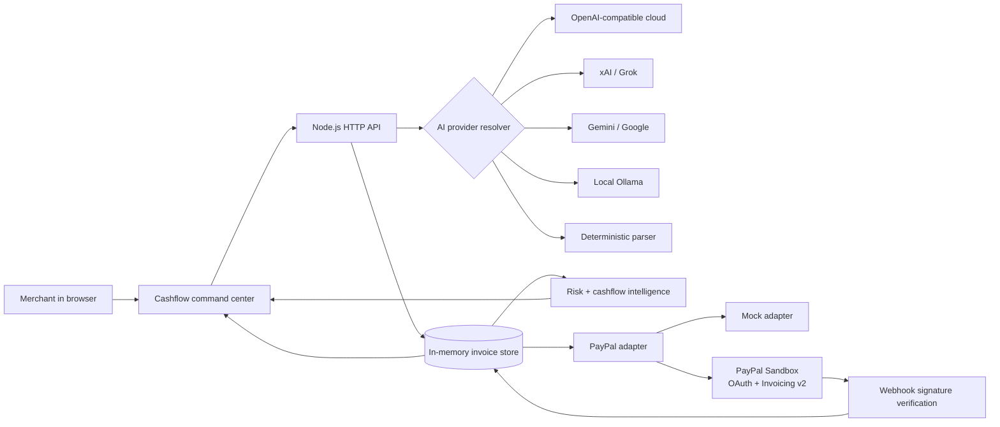
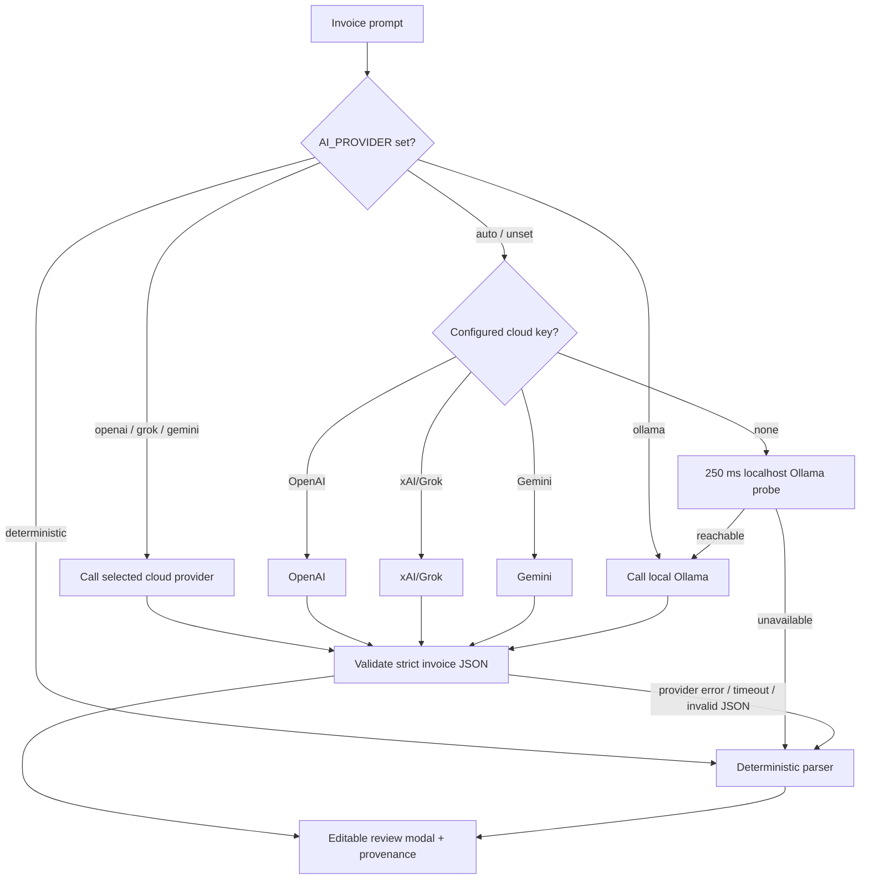
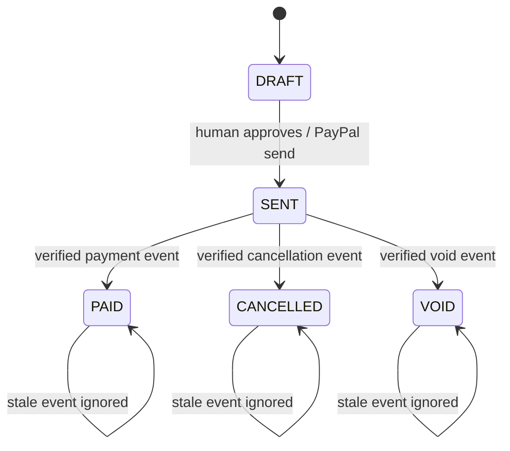

# PayPal Cashflow Copilot


**Say what needs to get paid. Review it. Let PayPal make it real.**

Cashflow Copilot is an offline-first, trust-first AI accounts-receivable operator for freelancers and small businesses. It turns natural language into a reviewable invoice, sends it through PayPal's Invoicing API, and reacts to invoice events with an explainable next step.

The repository includes a polished demo UI, a deterministic parser for offline judging, a PayPal Sandbox adapter, a Postman sponsor collection, and a reproducible test/Docker path. See [`docs/IDEATION.md`](docs/IDEATION.md) for the evidence-backed hackathon thesis and judge narrative.

> **Hackathon thesis:** this is not an AI invoice generator. It is a human-controlled cashflow operator that turns intent into a reviewable PayPal action, then turns payment events into an explainable next move.

## Contents

- [Product at a glance](#product-at-a-glance)
- [Architecture](#architecture)
- [Quick start](#quick-start)
- [Demo walkthrough](#demo-walkthrough)
- [AI providers](#ai-providers)
- [API surface](#api-surface)
- [Security and trust boundaries](#security-and-trust-boundaries)
- [Test and check](#test-and-check)
- [PayPal Sandbox](#paypal-sandbox)
- [Deployment](#deployment)
- [Project documents](#project-documents)

## Product at a glance

| Capability | What the judge can see |
| --- | --- |
| Intent extraction | A natural-language invoice request becomes editable structured data |
| Human approval | No invoice or reminder leaves without an explicit approval action |
| PayPal execution | Mock adapter works offline; PayPal Sandbox adapter uses OAuth + Invoicing v2 |
| Explainable intelligence | Risk, urgency, confidence, reason codes, and 7/14/30-day projections |
| Event integrity | Verified PayPal webhook path, idempotency, and stale-event protection |
| Provider flexibility | OpenAI, xAI/Grok, Gemini/Google, local Ollama, or deterministic fallback |
| Judge-ready UX | Command center, Copilot queue, trust loop, forecast, audit drawer, and provenance labels |

## Architecture



### Provider selection



### Invoice lifecycle and event integrity



The detailed architecture and event sequence are also available in [`docs/ARCHITECTURE.md`](docs/ARCHITECTURE.md).

## Quick start

Use Node.js 22 (the repository pins it in `.nvmrc`; Node 24 also works for the offline checks). There are no runtime dependencies.

```sh
npm ci
```

Copy `.env.example` to `.env` when running with a local environment loader, or export variables directly. Mock mode is used unless both `PAYPAL_CLIENT_ID` and `PAYPAL_CLIENT_SECRET` are set.

## Run the demo

```sh
npm start
```

Open <http://localhost:3000>. The server listens on `http://localhost:3000` (override with `PORT`). The UI is intentionally usable without credentials: it starts with seeded, synthetic data and uses the mock adapter.

For the winning-path demo:

1. Click the Copilot suggestion or enter an invoice request.
2. Review/edit the extracted recipient, items, tax, and due date.
3. Click **Approve & send with PayPal**.
4. Click **Simulate a paid invoice** to replay a `INVOICING.INVOICE.PAID` event.

The human approval gate is intentional. AI prepares and explains a financial action; the user approves it; PayPal processes it.

### No-key demo mode

No API key is required to run the product. With no provider keys and no Ollama installation, the app uses the deterministic parser and mock PayPal adapter. It labels the experience as synthetic/mock mode so the demo never overclaims a live transaction.

For a real local AI model without a paid API:

```sh
ollama pull llama3.2
# Leave AI_PROVIDER=auto; the app detects the local Ollama server.
npm start
```

### Production-shaped demo mode

When `PAYPAL_CLIENT_ID` and `PAYPAL_CLIENT_SECRET` are configured, invoice actions use PayPal Sandbox. When `PAYPAL_WEBHOOK_ID` and a public HTTPS URL are also configured, real PayPal webhook signatures can be verified at `/api/webhooks/paypal`.

## Demo walkthrough

1. Start the app and point out the current adapter and AI provenance labels.
2. Use the Copilot suggestion or enter: `Invoice Acme Design Co <accounts@acme.example> for 2 brand review sessions at $125 each, tax 8%, due in 15 days`.
3. Review the extracted customer, line items, tax, due date, total, and provider/model label.
4. Approve the invoice and open the invoice control room.
5. Show the Copilot queue explaining why Acme needs attention.
6. Send a reminder only after confirmation.
7. Click **Replay demo payment webhook** when running mock mode; it is explicitly labeled simulated.
8. Show the invoice moving to `PAID`, the activity proof, and the updated forecast.

Use [`docs/FINAL_HANDOFF.md`](docs/FINAL_HANDOFF.md) for the under-three-minute pitch script and the manual submission checklist.

## API surface

- `GET /api/state` — seeded invoices, summary totals, and active adapter.
- `GET /api/health` — secret-free service health with adapter, mode (`mock` or `sandbox`), process uptime in seconds, supported capabilities, and secret-free AI provider/model status.
- `GET /api/insights` — deterministic per-invoice risk, urgency, confidence and reason codes, projected incoming cash for 7/14/30 days, and the highest-priority next action.
- `POST /api/parse-invoice` with `{ "text": "Invoice for ... 2 hours at $150/hour" }` — provider-backed structured parsing with deterministic fallback. The response is `{ "invoice": { ... }, "ai": { "provider", "mode", "model", "fallback", "reason" } }`.
- `POST /api/invoices` — validate and create an in-memory draft.
- `POST /api/invoices/:id/send` — create/send through mock PayPal or the sandbox REST adapter.
- `POST /api/invoices/:id/remind` — send a PayPal invoice reminder through the mock or sandbox adapter and add an explainable timeline event.
- `POST /api/webhooks/simulate` with `{ "eventType": "INVOICING.INVOICE.PAID", "invoiceId": "..." }` — apply a supported invoice event. Lifecycle transitions are monotonic (`DRAFT → SENT → PAID/CANCELLED/VOID`); duplicate sends are rejected and stale webhooks are acknowledged without changing a terminal invoice.
- `POST /api/webhooks/paypal` — receive a real PayPal webhook only after verifying its signature through PayPal's `/v1/notifications/verify-webhook-signature` endpoint.

The sandbox adapter uses PayPal OAuth at `/v1/oauth2/token` and Invoicing API endpoints at `/v2/invoicing/invoices`, including `/remind`. Secrets are read from environment variables and are never included in application logs or API responses. Webhook simulation is intentionally demo-safe and idempotent: replaying the same event (or the same event type for an invoice when no event id is supplied) does not add another timeline entry. Real webhook ingestion is stricter: it requires `PAYPAL_WEBHOOK_ID`, PayPal signature headers, and a successful PayPal verification response before changing invoice state.

### AI providers

All AI providers use the OpenAI-compatible chat completions shape. `AI_PROVIDER=auto` is the default: it chooses configured cloud keys in this order (OpenAI, xAI/Grok, Gemini/Google), then makes one short local Ollama probe, and finally uses the deterministic parser. Cloud services are never probed without a key. Ollama is the no-key path; install it locally and pull a model first. Detection defaults to a bounded 250 ms probe and is cached briefly. Provider requests default to 10 seconds; override with `AI_TIMEOUT_MS`, `PAYPAL_TIMEOUT_MS`, or the shared `OUTBOUND_TIMEOUT_MS` (maximum 120 seconds).

OpenAI:

```sh
AI_PROVIDER=openai OPENAI_API_KEY=... OPENAI_BASE_URL=https://api.openai.com/v1 OPENAI_MODEL=gpt-4o-mini npm start
```

xAI/Grok:

```sh
AI_PROVIDER=grok/xai XAI_API_KEY=... XAI_BASE_URL=https://api.x.ai/v1 XAI_MODEL=grok-3-mini npm start
```

Gemini/Google:

```sh
AI_PROVIDER=gemini/google GEMINI_API_KEY=... GEMINI_BASE_URL=https://generativelanguage.googleapis.com/v1beta/openai/ GEMINI_MODEL=gemini-2.0-flash npm start
```

Ollama:

```sh
ollama pull llama3.2
AI_PROVIDER=ollama OLLAMA_BASE_URL=http://127.0.0.1:11434/v1 OLLAMA_MODEL=llama3.2 npm start
```

For automatic Ollama detection, leave `AI_PROVIDER=auto` and optionally set `OLLAMA_PROBE_URL=http://127.0.0.1:11434/api/tags` and `OLLAMA_PROBE_TIMEOUT_MS=250`. Provider responses are validated as invoice JSON and any provider, network, timeout, or malformed-response failure falls back silently to deterministic parsing. The API key and provider response are never logged. Free tiers and rate limits vary by provider; a configured key is not guaranteed to be free. Local Ollama is the no-key option. Tests inject fetch implementations and never call real providers.

## Security and trust boundaries

- Payment credentials and AI keys are read from environment variables only.
- Keys are never returned by `/api/health`, logged, or sent to the browser.
- AI output is schema-validated and all monetary totals are recalculated server-side.
- Every send/reminder action requires an explicit user action in the UI.
- Real PayPal webhook state changes require PayPal signature verification.
- Duplicate webhooks are idempotent; stale events cannot regress terminal state.
- Outbound AI and PayPal requests have bounded timeouts.
- The local demo uses synthetic data and an in-memory store; it is not a production data store.

## Test and check

Both commands are offline and need no services:

```sh
npm test
npm run check
```

`npm test` is the single offline test command required for this project. It covers parsing, cent-safe totals, strict validation, PayPal mock behavior, reminders, explainable insights, idempotent webhook transitions, AI provider routing, Ollama detection, AI fallback, health, security headers, and HTTP routes.

## Docker

```sh
docker build -t paypal-cashflow-copilot .
docker run --rm -p 3000:3000 paypal-cashflow-copilot
```

To use PayPal sandbox, pass both credentials at runtime with `-e PAYPAL_CLIENT_ID=... -e PAYPAL_CLIENT_SECRET=...`; do not put them in the image or source tree.

## PayPal Sandbox mode

Create a PayPal Developer app and export both credentials. The server obtains an OAuth 2.0 token and uses the documented Invoicing v2 endpoints to create/send invoices:

```sh
PAYPAL_CLIENT_ID=... PAYPAL_CLIENT_SECRET=... npm start
```

If either credential is absent, mock mode is selected. To wire real webhooks, create a webhook subscription in the PayPal Developer Dashboard, set its URL to `https://YOUR_HOST/api/webhooks/paypal`, copy its webhook ID into `PAYPAL_WEBHOOK_ID`, and keep the sandbox credentials configured. See [`postman/PayPal-Cashflow-Copilot.postman_collection.json`](postman/PayPal-Cashflow-Copilot.postman_collection.json) for an inspectable Postman collection covering the local app plus direct PayPal Sandbox references. Never commit `.env` or secrets.

## Project documents

- [`docs/IDEATION.md`](docs/IDEATION.md) — evidence-backed product thesis and concept comparison
- [`docs/COMPETITIVE_REVIEW.md`](docs/COMPETITIVE_REVIEW.md) — judge-readiness review and remaining risks
- [`docs/ARCHITECTURE.md`](docs/ARCHITECTURE.md) — system, provider, lifecycle, and live webhook diagrams
- [`docs/FINAL_HANDOFF.md`](docs/FINAL_HANDOFF.md) — final pitch, manual setup, and submission handoff
- [`postman/PayPal-Cashflow-Copilot.postman_collection.json`](postman/PayPal-Cashflow-Copilot.postman_collection.json) — inspectable API collection

## Deploy

The container listens on `$PORT` (default `3000`) and can be deployed to any container host that supports Node 22. For a hosted hackathon demo, set `PORT`, `PAYPAL_CLIENT_ID`, and `PAYPAL_CLIENT_SECRET` as platform secrets, then expose the container's HTTP port. The in-memory store is a prototype boundary; production should add durable storage and webhook signature verification before handling real customer data.
