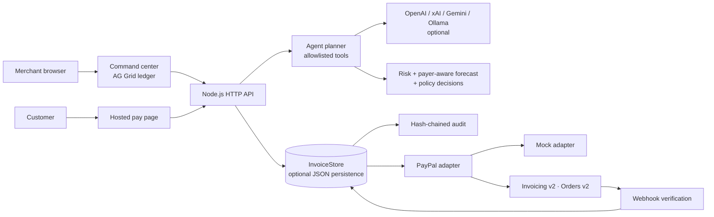

# Cashflow Copilot


**The AI accounts-receivable operator that tells you which invoice to chase next — and only moves money after you approve.**

Cashflow Copilot turns a sentence into a validated PayPal invoice, predicts **when each invoice will actually be paid** using that payer's history, ranks the one action that moves cash this week, and then executes it through PayPal only after explicit approval. Every step is explained, policy-gated, and hash-chained.

Built for the **PayPal AI Hackathon: Build What's Next** (Oct–Nov 2026).


> **The quantified differentiator:** on a deterministic synthetic ledger, payer-aware forecasting reduces mean absolute error for payment-date prediction by **70.4% versus a due-date baseline** (2.36 days vs 7.98 days). The backtest is committed and reproducible with `npm run backtest` — see [`docs/FORECAST_BACKTEST.md`](docs/FORECAST_BACKTEST.md).

---

## Contents

- [Why this is not another invoice generator](#why-this-is-not-another-invoice-generator)
- [The 90-second judge tour](#the-90-second-judge-tour)
- [Live vs demo (what is actually proven)](#live-vs-demo-what-is-actually-proven)
- [Architecture](#architecture)
- [Quick start](#quick-start)
- [PayPal Sandbox mode](#paypal-sandbox-mode)
- [AI, the agent, and the approval gate](#ai-the-agent-and-the-approval-gate)
- [Forecasting with receipts](#forecasting-with-receipts)
- [Trust, policy, and security](#trust-policy-and-security)
- [Sponsor integrations](#sponsor-integrations)
- [API surface](#api-surface)
- [Tests and evidence](#tests-and-evidence)
- [Deploy](#deploy)
- [Repository map](#repository-map)
- [Submission assets](#submission-assets)
- [License and third-party notices](#license-and-third-party-notices)

---

## Why this is not another invoice generator

The PayPal AI Hackathon's AR/invoicing space is crowded. Most projects stop at "AI writes an invoice." Cashflow Copilot owns the harder half of accounts receivable:

| Most invoice demos | Cashflow Copilot |
| --- | --- |
| Generates invoice text | Generates a **validated, editable proposal**, then recalculates every total server-side in cents |
| Sends an invoice | Creates/sends/reminds/cancels through **PayPal Invoicing v2**, and creates **PayPal Checkout** links for customers |
| Says "paid" | Moves to PAID only on a **verified PayPal webhook or a confirmed capture**, with idempotency and stale-event protection |
| Shows a chart | Predicts **when** each invoice will be paid from payer history, with basis and confidence |
| Asks an LLM for advice | Runs a **planner with an allowlist of financial tools**; the model can propose, never execute |
| Logs actions | Keeps a **SHA-256 hash-chained audit trail** you can verify from the UI or API |
| Hard-codes rules in prompts | Keeps collections rules in **`policies/collections.json`**, with the exact rule id and numeric inputs attached to every recommendation |

The product's loop is: **Signal → Approve → PayPal → Verify**.

---

## The 90-second judge tour

No credentials, no API keys, no network required.

```sh
git clone https://github.com/sidg2hp/paypal.git
cd paypal
npm start
```

Open <http://localhost:3000>.

1. **Read the signal.** The command center shows `$737.13` outstanding across two sent invoices, one overdue invoice, and a payer-adjusted 30-day forecast. The queue explains *why* Acme Design Co is first: 8 days past due, 99% confidence, policy rule `REMINDER_ALLOWED`.
2. **Ask the Copilot.** Click **Who should I chase today?** The agent answers with the portfolio state and proposes two steps: remind Acme, send the Meridian draft. Nothing has executed.
3. **Approve one step.** Untick the draft and click **Approve selected**. Only the reminder runs; the audit trail records it.
4. **Draft an invoice from a sentence.** Click **Draft an invoice from a sentence**. Review the extracted customer, line items, tax, currency, and due date. Totals are recalculated by the server.
5. **Watch the customer side.** Open an invoice drawer → **Create payment link** → **Open checkout**. The hosted pay page shows the invoice and a PayPal button (or a labelled mock checkout in demo mode). Pay it; the invoice moves to PAID and the forecast changes.
6. **Verify the proof.** Click **Verify audit chain**. Every event is SHA-256 chained; tampering with an earlier event breaks every later hash.

The same flow is scripted in [`docs/DEMO_SCRIPT.md`](docs/DEMO_SCRIPT.md) for the under-three-minute video.

---

## Live vs demo (what is actually proven)

Honesty is part of the design. The UI always labels the active mode, and this table is the canonical claim boundary.

| Capability | Demo mode (default, no keys) | PayPal Sandbox mode (credentials set) | Evidence |
| --- | --- | --- | --- |
| Invoice create/send/remind/cancel | Mock adapter, clearly labelled | Invoicing v2 REST | Unit tests with mocked PayPal responses; `npm run sandbox:check` for a real run |
| Customer checkout | Mock order + mock capture | Orders v2 create + capture, buyer redirected to PayPal | Unit tests; sandbox script covers invoicing, not checkout |
| Webhook state changes | Labelled simulation | Signature verified by PayPal before any change | Tests cover valid, invalid, duplicate, stale, and untrusted cert URL |
| AI extraction / planner | Deterministic fallback, labelled | OpenAI-compatible provider, validated JSON, deterministic fallback | `npm run eval` 16/16 goldens |
| Forecast | Payer-aware model over local history | Same model over sandbox history | `npm run backtest` |
| Audit chain | Real SHA-256 chain | Real SHA-256 chain | `GET /api/audit`, tests |
| Persistence | In-memory by default; optional JSON file | Same | Persistence round-trip test |

A real sandbox run has **not** been committed in this repository yet. Run `npm run sandbox:check` with your credentials before submission and commit the generated JSON under [`docs/sandbox-evidence/`](docs/sandbox-evidence/). Do not claim a live run you cannot show.

---

## Architecture



Detailed diagrams and sequence flows live in [`docs/ARCHITECTURE.md`](docs/ARCHITECTURE.md).

### Module map

| Module | Responsibility |
| --- | --- |
| `src/core.js` | Validation, cent-safe totals, PayPal adapters, lifecycle, insights integration |
| `src/agent.js` | Deterministic and LLM planners, allowlisted tool execution, plan TTL |
| `src/policy.js` | Policy as data; named rules for reminders and send limits |
| `src/forecast.js` | Payer statistics, expected payment date, projections, backtest |
| `src/audit.js` | SHA-256 chain append and verification |
| `src/persistence.js` | Optional atomic JSON persistence |
| `src/server.js` | Routing, security headers, CSRF/origin checks, rate limiting, pay page, webhooks |

---

## Quick start

Requirements: **Node.js 22 or newer** (the repo pins 22 in `.nvmrc`; verified on Node 24). There are no runtime dependencies.

```sh
npm ci
npm start
# http://localhost:3000
```

Useful commands:

```sh
npm test            # 58 offline tests
npm run check       # syntax checks across every source file
npm run eval        # 16 golden parser/planner cases
npm run backtest    # regenerate docs/FORECAST_BACKTEST.md
npm run verify      # check + test + eval
```

Optional persistence across restarts:

```sh
DATA_FILE=./data/store.json npm start
```

Optional policy override:

```sh
POLICY_FILE=./policies/collections.json npm start
```

---

## PayPal Sandbox mode

1. Create a PayPal Developer account and a **Sandbox REST app**.
2. Copy the client id and secret.
3. Start the server with both:

```sh
PAYPAL_CLIENT_ID=... PAYPAL_CLIENT_SECRET=... npm start
```

The server switches to `paypal-sandbox` (visible in `/api/health`, the sidebar, and the banner). It then uses:

| PayPal capability | Endpoint |
| --- | --- |
| OAuth 2.0 | `POST /v1/oauth2/token` |
| Create invoice | `POST /v2/invoicing/invoices` |
| Send invoice | `POST /v2/invoicing/invoices/{id}/send` |
| Read invoice | `GET /v2/invoicing/invoices/{id}` |
| Remind invoice | `POST /v2/invoicing/invoices/{id}/remind` |
| Cancel invoice | `POST /v2/invoicing/invoices/{id}/cancel` |
| Create checkout order | `POST /v2/checkout/orders` |
| Capture checkout order | `POST /v2/checkout/orders/{id}/capture` |
| Verify webhook | `POST /v1/notifications/verify-webhook-signature` |

**Tax correctness:** PayPal invoices are built with per-item `tax` objects allocated from the invoice total, so the PayPal invoice total equals the amount shown in the app. The previous implementation silently omitted tax; `tests/core.test.js` now asserts the parity.

**Webhooks:** create a webhook subscription pointing at `https://YOUR_HOST/api/webhooks/paypal`, set `PAYPAL_WEBHOOK_ID`, and keep both credentials configured. The route requires the five `PAYPAL-*` signature headers, asks PayPal to verify the event, restricts the certificate URL to PayPal hosts, deduplicates by event id, and only then changes state.

Full walkthrough: [`docs/SANDBOX_SETUP.md`](docs/SANDBOX_SETUP.md).

---

## AI, the agent, and the approval gate

The app works with **no AI key** and gets better with one. Provider selection is `AI_PROVIDER=auto` by default: configured OpenAI → xAI/Grok → Gemini, then a bounded local Ollama probe, then the deterministic planner.

### Two planners, one allowlist

- **Deterministic planner** classifies intent (collections review, reminder batch, forecast, draft invoice, payment link, explain, cancel) and composes an answer from real invoice data. This is what runs in the zero-key demo.
- **LLM planner** sends a compact data context to an OpenAI-compatible chat endpoint and asks for JSON with `intent`, `answer`, and `actions`. The response is parsed, every action is checked against the allowlist, and every invoice id must exist in the store. Invalid output falls back to the deterministic plan.

### What the model can never do

- It cannot invent an invoice id, amount, or customer.
- It cannot execute an action. `POST /api/copilot/plan` only returns proposals with a 15-minute TTL.
- It cannot bypass policy. Reminder recommendations carry the policy decision (`REMINDER_ALLOWED`, `COOLDOWN_ACTIVE`, `REMINDER_LIMIT_REACHED`, `BELOW_MIN_AMOUNT`, `SEND_LIMIT_EXCEEDED`).
- It cannot move money outside `POST /api/copilot/execute` with explicit step ids approved by the merchant.

### Measured AI fallback quality

```sh
npm run eval
# 16/16 golden cases passed
```

The goldens cover the two exact demo prompts, labelled customers, multi-line invoices, thousands separators, hourly items, percentage-first tax, euro symbols, malformed input, and six planner intents. `tests/agent.test.js` additionally proves that model plans with invented invoice ids or unknown tools are rejected.

### Provider examples

```sh
# OpenAI
AI_PROVIDER=openai OPENAI_API_KEY=... npm start

# xAI / Grok
AI_PROVIDER=grok/xai XAI_API_KEY=... npm start

# Gemini / Google
AI_PROVIDER=gemini/google GEMINI_API_KEY=... npm start

# Local Ollama (no key)
ollama pull llama3.2
AI_PROVIDER=ollama npm start
```

Keys are read from the environment only, never returned by `/api/health`, and never logged.

---

## Forecasting with receipts

The model is deliberately small and explainable:

```text
expected payment date = due date + median observed lateness for that payer
```

Fallbacks: portfolio median (when there are at least five settled invoices), then the due date. Every insight exposes `forecastBasis`, `forecastConfidence`, `payerMedianLatenessDays`, and `payerPaidCount`.

`npm run backtest` generates a deterministic synthetic ledger (8 payers, 144 settled invoices), trains on 70%, and scores the model against two baselines:

| Model | MAE | RMSE | Within 3 days | Within 7 days |
| --- | ---: | ---: | ---: | ---: |
| Due-date baseline | 7.98 d | 11.33 d | 52.3% | 59.1% |
| Global median lateness | 7.11 d | 9.11 d | 22.7% | 65.9% |
| **Payer median lateness** | **2.36 d** | **3.30 d** | **72.7%** | **95.5%** |

Exact numbers and methodology: [`docs/FORECAST_BACKTEST.md`](docs/FORECAST_BACKTEST.md). This is a synthetic calibration harness, not a claim about real merchants; replace the generator with exported rows to run it on real history.

---

## Trust, policy, and security

- **Human approval gate.** Drafts and reminders require an explicit UI action. Agent plans require per-step approval server-side.
- **Policy as data.** `policies/collections.json` controls reminder minimums, cooldowns, limits, and send caps. Every decision carries `ruleId`, `rule`, `inputs`, `allowed`, and `decision`.
- **Hash-chained audit.** Every event stores `prevHash` and `hash`; `GET /api/audit` recomputes the chain and reports the first broken link.
- **Payment integrity.** Monotonic lifecycle (`DRAFT → SENT → PAID/CANCELLED/VOID`, `PAID → REFUNDED`), duplicate-send locks, idempotent webhooks, and stale-event protection.
- **Webhook hardening.** Signature verification through PayPal, PayPal-host allowlist for the certificate URL, required headers, duplicate event ids, unsupported events acknowledged without state changes.
- **Financial arithmetic.** Integer-cent rounding everywhere; the model never performs arithmetic; the server recalculates every total.
- **Transport and browser hardening.** CSP (strict `script-src 'self'`), `X-Frame-Options: DENY`, `nosniff`, no-referrer, permissions policy, same-origin enforcement, and per-IP rate limits on reads, writes, and payment routes.
- **Secret hygiene.** No secret is returned by the API or written to logs; `npm run sandbox:check` records debug ids but never credentials.

---

## Sponsor integrations

| Sponsor | How it is used | Where |
| --- | --- | --- |
| **AG Grid** (Community, MIT) | The receivables ledger is a real AG Grid with sorting, custom status/risk renderers, stable row ids, and click-through to the audit drawer. Vendored, so the demo works offline. | `public/vendor/ag-grid/`, `initLedger()` in `public/app.js` |
| **APIMatic** | OpenAPI 3.1 contract, APIMatic build directory, offline Redocly validation, and the official PayPal Server SDK **Context Plugin** vendored for inspection. | `openapi/`, `docs/APIMATIC.md`, `docs/apimatic/` |
| **Render** | A `render.yaml` Blueprint with a health check, proxy-aware settings, optional secrets, and a documented persistent-disk upgrade path. | `render.yaml`, `docs/DEPLOY.md` |
| **Postman** | A runnable collection covering the local app, PayPal Invoicing v2, and Orders v2 checkout. | `postman/` |

We evaluated **Bryntum**, **Channel3**, and **Elastic** and did not force them in: a Gantt/Calendar component, a product catalog, and a search cluster do not make an AR workflow better in the time available. The reasoning is documented in [`docs/SPONSORS.md`](docs/SPONSORS.md) so the choice is deliberate rather than a checkbox.

> If submitting for a sponsor prize, **select the sponsor tool on the Devpost form**. A repository mention alone does not enter you for the bonus.

---

## API surface

The full contract is [`openapi/openapi.yaml`](openapi/openapi.yaml) (also JSON). Highlights:

| Method | Route | Purpose |
| --- | --- | --- |
| GET | `/api/health` | Secret-free adapter, capability, AI status |
| GET | `/api/state` | Invoices, summary, policy, runtime metadata |
| GET | `/api/insights` | Risk, reasons, policy decisions, payer-adjusted forecast |
| GET | `/api/policy` | Policy and its decision ledger |
| GET | `/api/audit` | Verify the hash chain |
| POST | `/api/parse-invoice` | Natural language → validated draft + AI provenance |
| POST | `/api/invoices` | Create a draft |
| POST | `/api/invoices/{id}/send` | Create/send through PayPal |
| POST | `/api/invoices/{id}/remind` | Send a reminder |
| POST | `/api/invoices/{id}/cancel` | Cancel locally and at PayPal |
| POST | `/api/invoices/{id}/payment-link` | Create/reuse a Checkout order and pay URL |
| POST | `/api/copilot/plan` | Agent answer + proposed steps |
| POST | `/api/copilot/execute` | Execute only approved, unexpired steps |
| GET | `/api/pay/{token}` | Customer-safe invoice projection |
| POST | `/api/pay/{token}/order` | Create/reuse the customer order |
| POST | `/api/pay/{token}/capture` | Confirm payment and mark PAID |
| POST | `/api/webhooks/simulate` | Labelled demo event replay |
| POST | `/api/webhooks/paypal` | Verified PayPal webhook ingestion |
| POST | `/api/demo/reset` | Reseed the demo (optional bearer token) |

---

## Tests and evidence

```text
npm test        58 passing (parser, money, policy, forecast, audit, persistence,
                agent, checkout, webhook, HTTP security, rate limiting)
npm run eval    16/16 golden cases
npm run check   syntax checks across src/, public/, scripts/
npm run backtest  70.4% MAE improvement over due-date baseline
```

The suite is fully offline: PayPal and AI providers are injected with deterministic fakes. No test calls a real provider.

Additional evidence documents:

- [`docs/FORECAST_BACKTEST.md`](docs/FORECAST_BACKTEST.md) — reproducible forecast numbers
- [`docs/LIVE_VS_DEMO.md`](docs/LIVE_VS_DEMO.md) — claim boundary table
- [`docs/SANDBOX_SETUP.md`](docs/SANDBOX_SETUP.md) — real PayPal setup and evidence run
- [`docs/APIMATIC.md`](docs/APIMATIC.md) — sponsor integration and validation output
- [`docs/AGENTIC_COMMERCE.md`](docs/AGENTIC_COMMERCE.md) — mapping to PayPal's agent-payments vocabulary

---

## Deploy

**Render (recommended):** connect the repo, choose **New → Blueprint**, and apply `render.yaml`. The service starts in mock mode immediately; add PayPal Sandbox credentials in the dashboard to switch adapters. Free instances spin down after 15 minutes idle, so warm the URL before recording the video.

**Docker:**

```sh
docker build -t cashflow-copilot .
docker run --rm -p 3000:3000 cashflow-copilot
```

For sandbox credentials, pass them at runtime (`-e PAYPAL_CLIENT_ID=... -e PAYPAL_CLIENT_SECRET=...`). Never bake secrets into the image.

**Persistence:** set `DATA_FILE` to a writable path. Render's free tier has an ephemeral filesystem; use a paid instance with a disk, or accept reseeding.

Full deployment notes: [`docs/DEPLOY.md`](docs/DEPLOY.md).

---

## Repository map

```text
src/                 HTTP server, domain core, agent, policy, forecast, audit, persistence
public/              Dashboard, hosted pay page, styles, vendored AG Grid
policies/            Collections policy as data
openapi/             OpenAPI 3.1 contract + APIMatic build file
postman/             Runnable API collection
tests/               58 offline tests
scripts/             eval, backtest, real sandbox evidence run
docs/                Architecture, submission, demo, sponsor, forecast, security docs
render.yaml          Render Blueprint
Dockerfile           Non-root container with health check
```

---

## Submission assets

- [`docs/SUBMISSION.md`](docs/SUBMISSION.md) — Devpost field-by-field answers
- [`docs/DEMO_SCRIPT.md`](docs/DEMO_SCRIPT.md) — under-three-minute shot list and narration
- [`docs/FINAL_HANDOFF.md`](docs/FINAL_HANDOFF.md) — pre-submission checklist
- [`docs/COMPETITIVE_REVIEW.md`](docs/COMPETITIVE_REVIEW.md) — honest competitive read and remaining risks

---

## License and third-party notices

MIT — see [LICENSE](LICENSE). The license is visible in the repository's About section.

Third-party assets: AG Grid Community (MIT) and PayPal's APIMatic context plugin (MIT) are vendored with their licenses. See [`THIRD_PARTY_NOTICES.md`](THIRD_PARTY_NOTICES.md). PayPal and the PayPal logo are trademarks of PayPal, used only to describe the integration.
