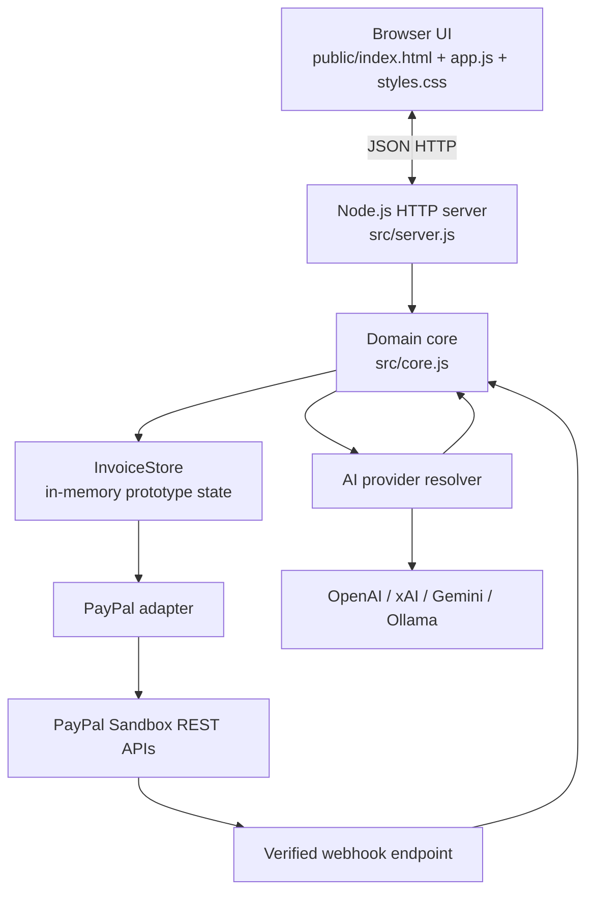
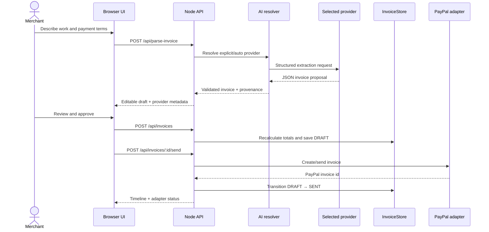
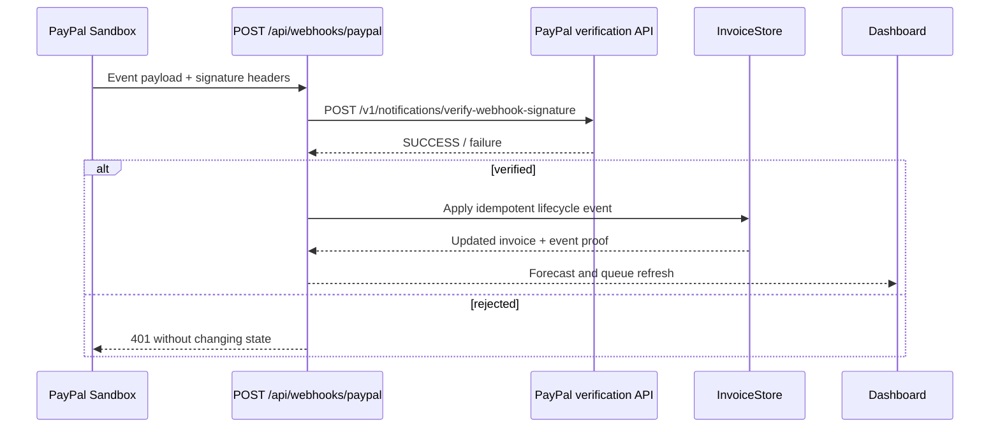

# Architecture: Cashflow Copilot

This document is the implementation map behind the README diagrams.

## Runtime topology

## Intent-to-invoice sequence

## Verified event sequence

## Design boundaries

| Boundary | Responsibility | Deliberate constraint |
| --- | --- | --- |
| Browser | Review, approval, provenance, feedback | Never receives secrets |
| HTTP server | Routing, JSON contracts, headers, errors | No framework/runtime dependency |
| Domain core | Validation, totals, lifecycle, provider routing | Recalculates all financial values |
| AI resolver | Select provider and validate structured output | Every failure falls back deterministically |
| PayPal adapter | OAuth, invoice actions, webhook verification | Sandbox by default when configured |
| InvoiceStore | Prototype state and audit timeline | In-memory; durable storage is a deployment requirement |

## Observability for a judge

- `GET /api/health` shows adapter mode and AI provider/model status without secrets.
- Parse responses include `ai.provider`, `ai.model`, `ai.mode`, and fallback reason.
- Invoice timelines distinguish app audit events, simulated webhooks, PayPal events, and verified PayPal webhooks.
- The UI always labels mock/synthetic/demo-safe behavior explicitly.
