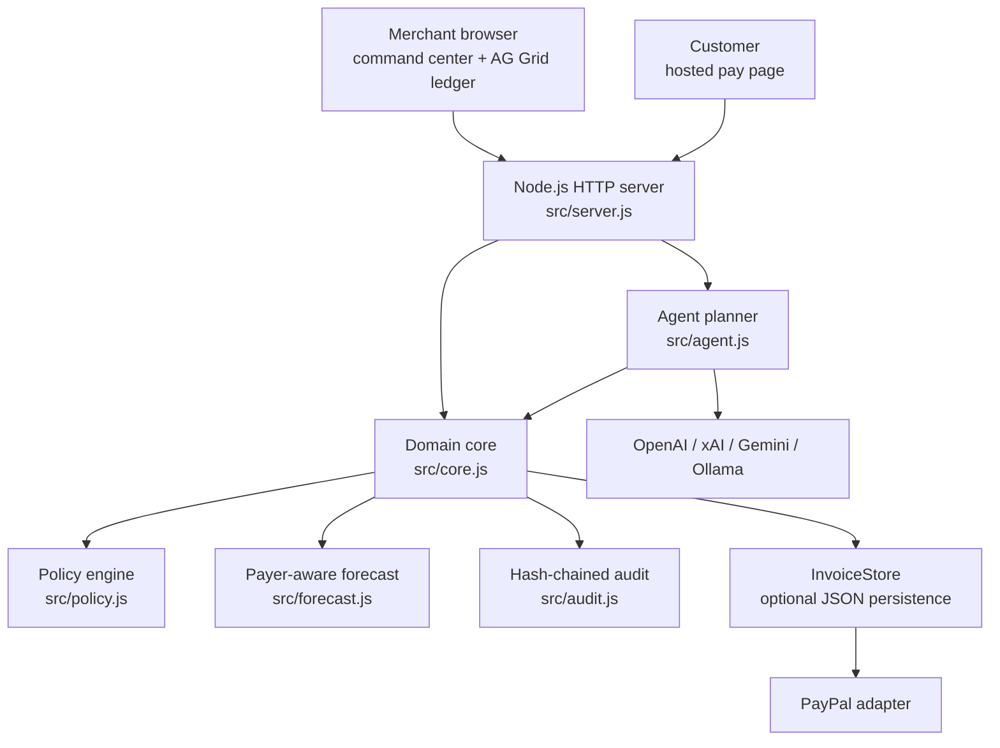
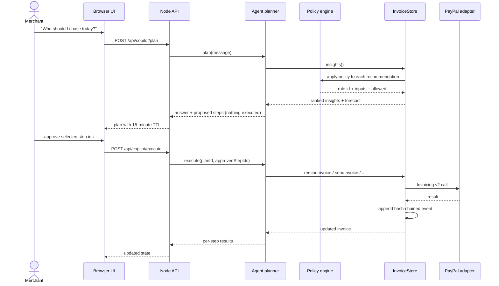
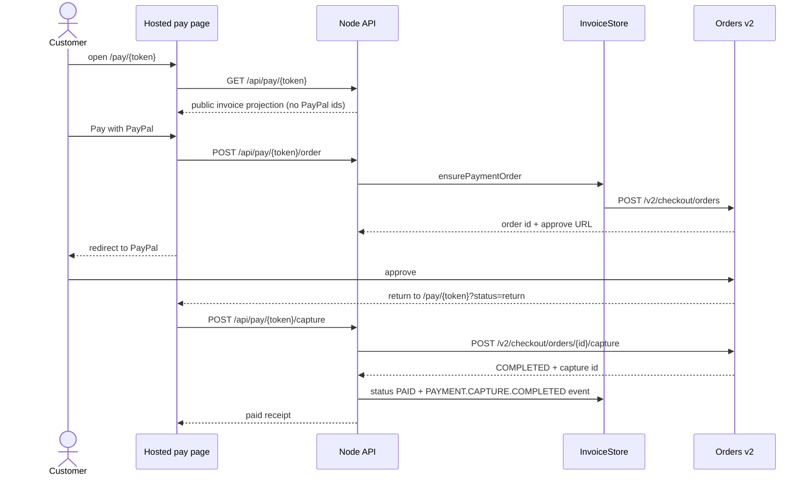
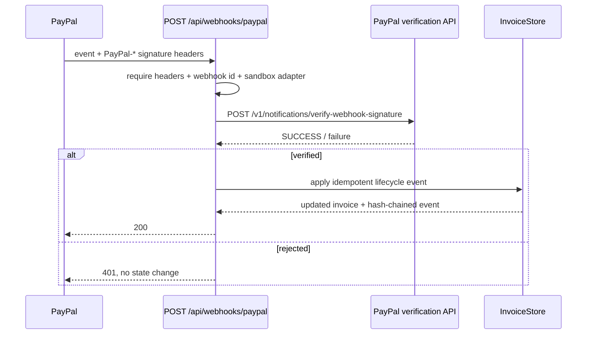
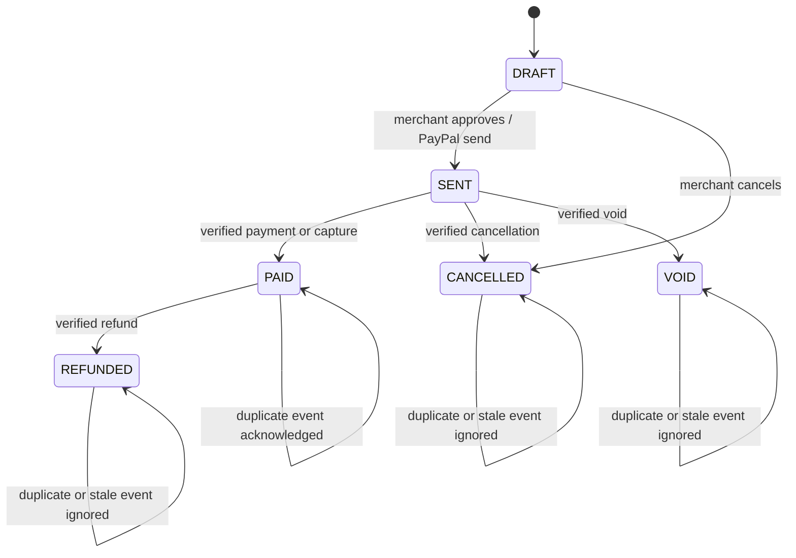

# Architecture

This is the implementation map behind the README diagrams.

## Runtime topology

## Request flow: intent to PayPal action

## Request flow: customer checkout

## Request flow: verified webhook

## Module boundaries

| Module | Responsibility | Deliberate constraint |
| --- | --- | --- |
| Browser | Review, approval, provenance, feedback | Never receives secrets or PayPal ids on the public pay page |
| `src/server.js` | Routing, JSON contracts, security headers, same-origin checks, rate limits, pay page | No framework or runtime dependency |
| `src/core.js` | Validation, cent-safe totals, lifecycle, adapters, insights integration | Recalculates every financial value server-side |
| `src/agent.js` | Intent classification, LLM planning, allowlisted execution | Model output is validated; unknown tools/ids dropped; plans expire |
| `src/policy.js` | Collections rules as data | Every decision carries rule id and numeric inputs |
| `src/forecast.js` | Payer statistics and expected payment date | Pure functions, reusable by the backtest |
| `src/audit.js` | SHA-256 chain | Every event includes `prevHash` and `hash` |
| `src/persistence.js` | Optional durable JSON | Atomic writes, debounced, no secrets |
| PayPal adapter | OAuth, Invoicing v2, Orders v2, webhook verification | Sandbox by default; cert URL restricted to PayPal hosts |
| `InvoiceStore` | Prototype state and audit timeline | In-memory by default; durable storage is a deployment choice |

## Invoice lifecycle

## Trust boundaries

1. **Model boundary.** The LLM sees a compact data snapshot and returns JSON. It
   never receives database handles, adapter credentials, or an execution path.
2. **Policy boundary.** Reminder and send permissions are decided outside the
   model, in `policies/collections.json`.
3. **Approval boundary.** A plan is inert until the merchant submits specific
   step ids. Drafts and reminders have their own UI confirmations.
4. **Payment boundary.** The app never sees card data. PayPal processes payment;
   the app stores invoice metadata and audit events.
5. **Event boundary.** State changes from PayPal require signature verification;
   simulated events are labelled and cannot masquerade as live.
6. **Data boundary.** The public pay projection excludes merchant-only fields
   (`paypalInvoiceId`, order ids, events, internal notes).

## Observability for a judge

- `GET /api/health` — adapter, mode, version, capabilities, AI status, no secrets.
- `GET /api/insights` — risk, reasons, policy decisions, payer-adjusted forecast.
- `GET /api/audit` — recomputed hash chain and first broken link.
- Plan responses include `ai.provider`, `ai.model`, `ai.fallback`, and `ai.reason`.
- Every UI event label distinguishes seed, simulated, PayPal, verified webhook,
  and Copilot-approved actions.

## Performance notes

- No database, no framework, no runtime dependency; startup is instant.
- Insights and payer statistics are O(invoices) and recomputed per request; the
  demo has four invoices. A production system would cache and paginate.
- Outbound AI and PayPal requests have bounded timeouts (default 10 s, max 120 s).
- Rate limits are in-memory per process; a multi-instance deployment would move
  them to a shared store.
